<div align="center">

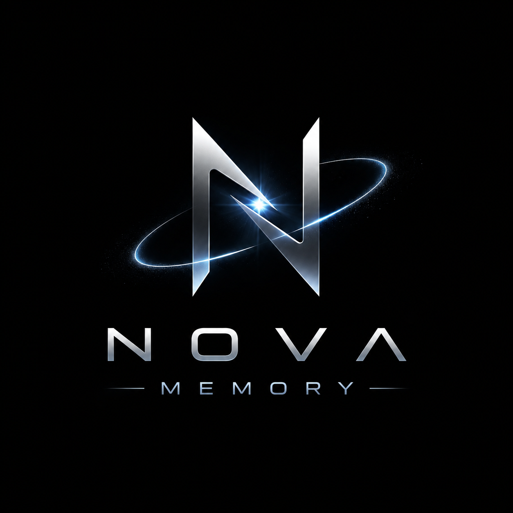

# Nova Memory

**Let understanding accumulate. Carry collaboration forward.**

After a local build, the workbench can keep collaboration materials with their sources, applicable context, and later corrections, and carry that context into the next collaboration within the access currently granted.

This repository is a **local source preview for Apple Silicon Macs**. You build it from source before opening it. Developer ID signing, notarization, and cross-device installer validation are still being prepared.

[](LICENSE) [](#get-started)

[Get started](#get-started) · [Workbench](#inside-the-workbench) · [Origins](#it-started-with-conversations-on-my-commute) · [Product](#the-product) · [Memory structure](#how-memory-structure-can-grow) · [Connections](#connect-the-ai-tools-you-use) · [Vision](#the-long-term-vision) · [简体中文](README.md)

</div>

**Build prerequisites** are the same system and tool conditions already written under “Build prerequisites” below and in the [getting-started guide (中文)](docs/GETTING_STARTED.md):

- Apple Silicon Mac running macOS 14 or later.
- Xcode with the macOS SDK, Rust 1.97.1 and Python 3.11 or later.

The build downloads dependencies and uses Xcode's command-line tools. If the system cannot find a compiler, confirm in Xcode settings that the command-line tools are installed and selected.

## Get started

The public delivery is a local source preview. Developer ID signing, notarization and cross-device installer validation are being prepared.

**Build prerequisites**

- Apple Silicon Mac running macOS 14 or later.
- Xcode with the macOS SDK, Rust 1.97.1 and Python 3.11 or later.

```sh
git clone https://github.com/JayeeeJY/nova-memory.git
cd nova-memory
cargo fetch --locked
./script/build_and_run.sh
```

Open the App, choose **开始本地使用**, and save a material with **留住一段记忆**. Configure a model when ready, then choose an AI platform in **连接**.

The default data directory is `~/Library/Application Support/Nova Memory/local-workspace-v03`. Original materials can be saved while model setup is pending.

[Full getting-started and build guide (中文)](docs/GETTING_STARTED.md) · [Report an issue](https://github.com/JayeeeJY/nova-memory/issues) · [Contribute](CONTRIBUTING.md)

This repository is a **local source preview**. Website imagery presents the product design and research direction. Workbench screenshots use the actual local interface and fictional Atlas project materials. See the [image provenance](docs/media/README.md).

## Inside the workbench

### See how memory connects

The memory space visualizes the current Vault's sources, extraction records, topics and supported relationships. Select a node or an edge to return to its underlying object and evidence. A corresponding list provides another way to inspect the same projection.

The view reflects changes in the stored materials and versions. Its relationships have stated origins, while the quality of the accumulated structure continues to be evaluated through use.

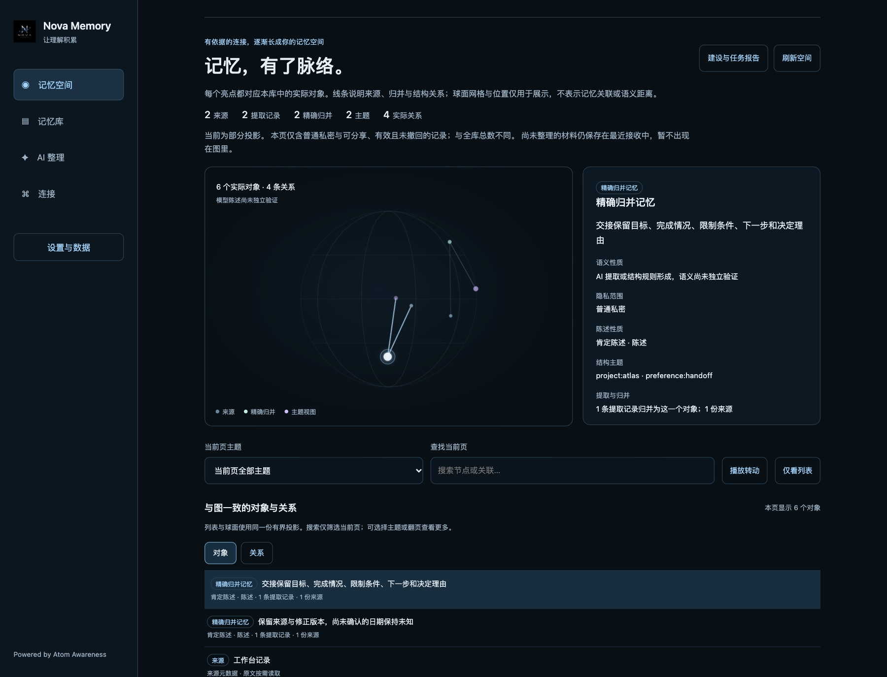

### Capture with little ceremony

Save text in the workbench, or say **“Save to Nova Memory”** in a connected AI. Once the platform connection is configured, daily capture uses that existing entry point.

The original is saved first. Cleaning and structuring follow the selected model and processing settings. If a model has yet to be configured, the material remains available while it waits. Saved, processing and reusable states are shown separately.

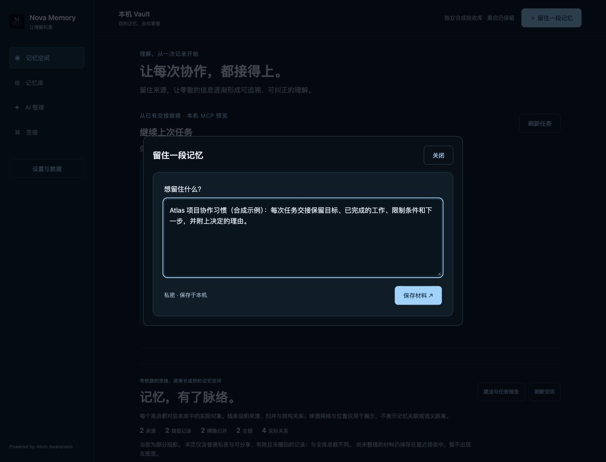

### Keep the meaning and its evidence together

Browse evolving project and topic views, inspect sources and conditions, examine versions and select relevant memories for another task. Matching statements can be displayed together while retaining their supporting sources.

A meeting preference is more useful when you can also see who expressed it, which project it applies to, its exceptions and when to reconsider it.

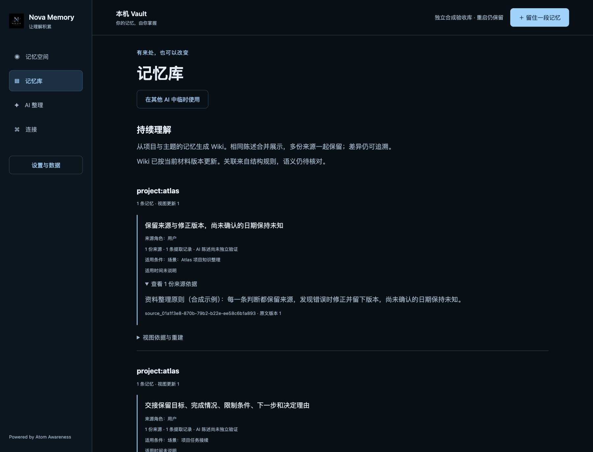

### Correct the understanding as you go

User statements, extracted claims and AI inferences retain their roles. Plans, negation and unknown information remain distinguishable. Tell Nova what is inaccurate or which circumstances a statement applies to, and preserve the correction with its evidence and history.

Extraction quality depends on the configured model. Originals, processing status and revisions give you a way to inspect and improve the result.

<details>
<summary>View the organization interface</summary>

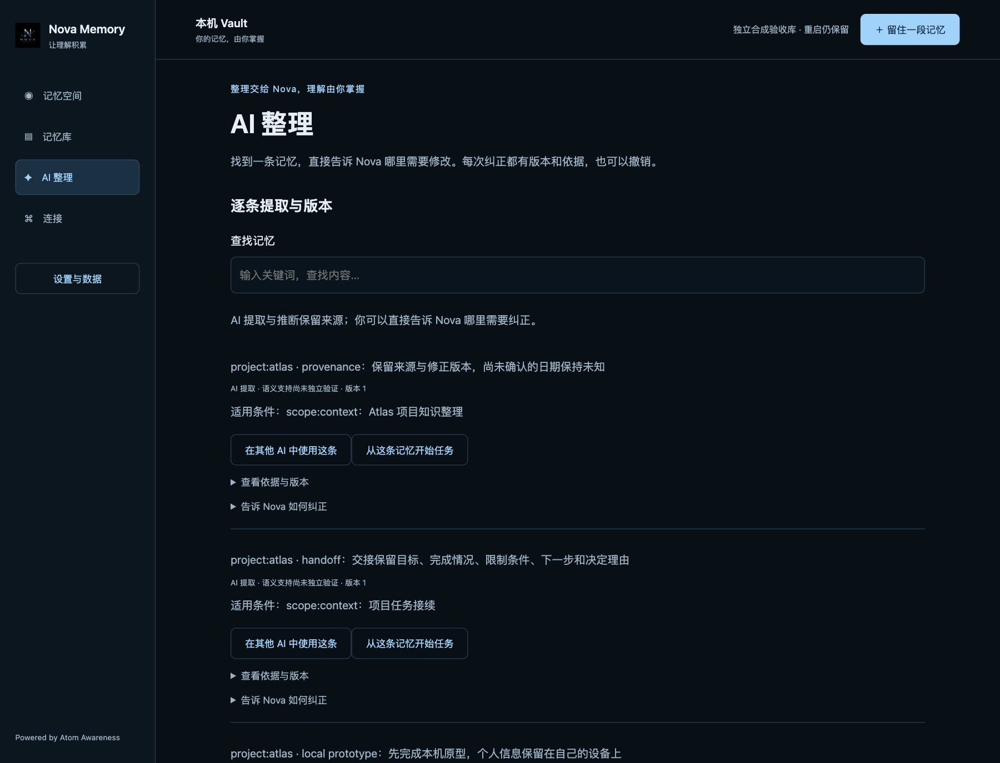

</details>

### Continue in another AI

Choose a platform and the workbench prepares the appropriate connection steps and configuration. For ongoing use, authorized clients can read from the same Vault. For a temporary task, choose a few memories, preview their context and copy or download it.

Task continuity can preserve the goal, completed work, rationale, constraints, failed attempts and next steps. An existing memory can become the starting point for a new task.

<details>
<summary>Continue from an existing handoff</summary>

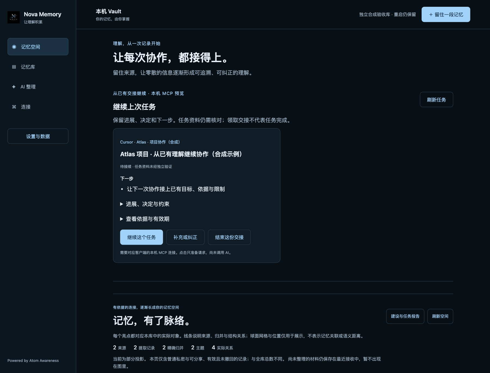

</details>

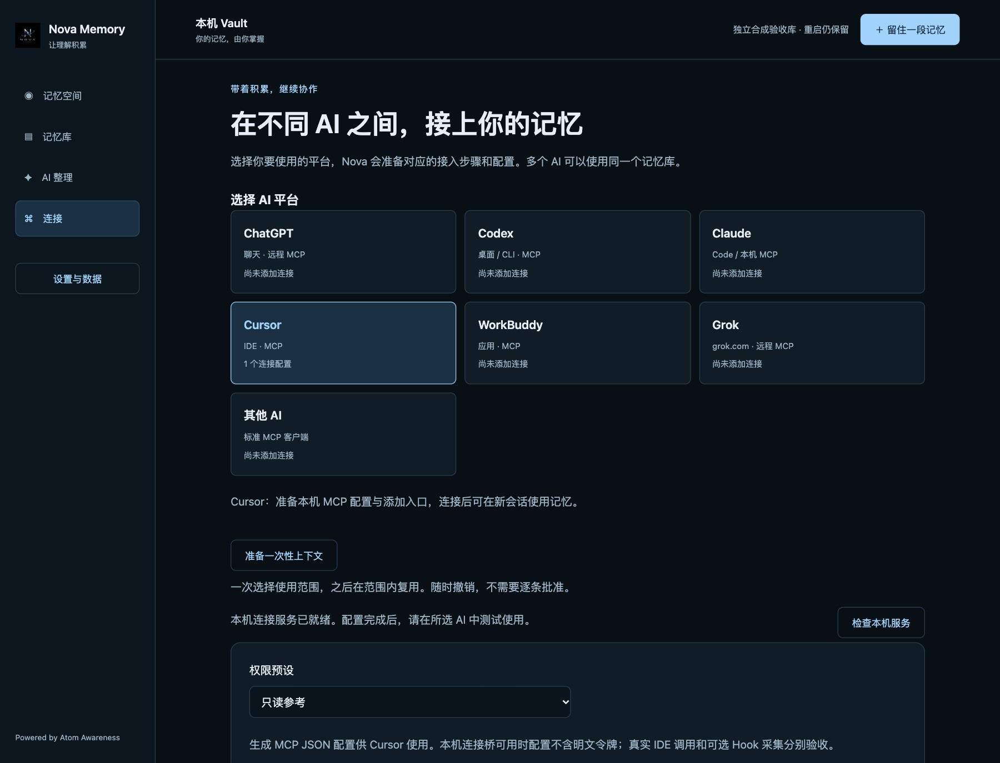

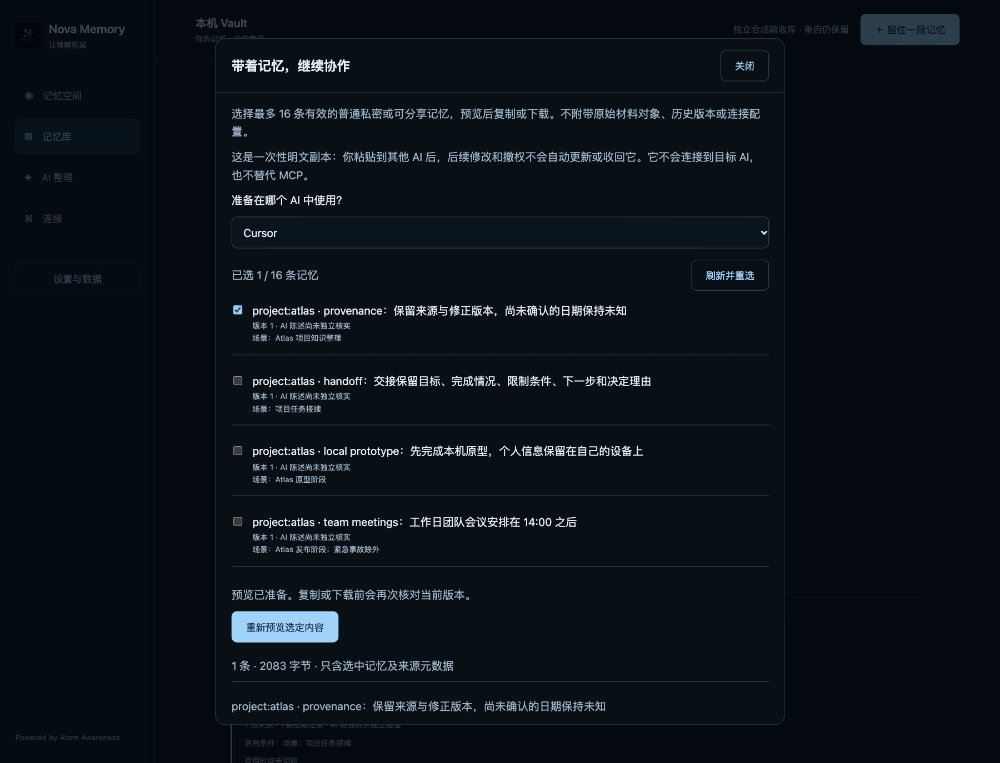

A text copy is retained by its recipient. Later corrections and revocation control subsequent Nova reads; copies already shared need to be managed in the receiving tool.

Next is the rest of the product introduction: its origin, the website images and panorama, the memory research, the boundaries of control, platform connections, and the long-term vision.

A local memory workspace that preserves useful context, its sources and its changes, ready for your next AI collaboration.

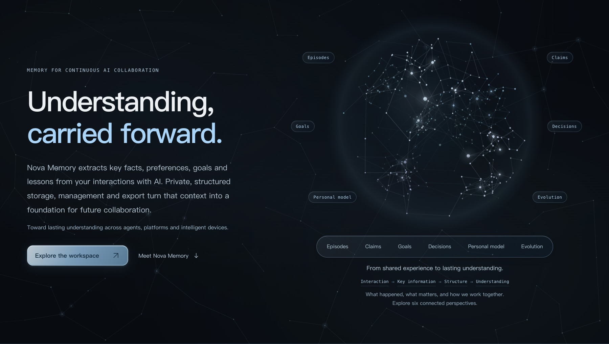

You have already explained your project, preferences, decisions and next steps to one AI. A different tool or a new conversation often asks you to establish that context again.

Nova Memory turns useful collaboration context into a personal asset you can maintain. Keep the original words, their source, the conditions that matter and the history of a change. Let an authorized AI pick up the relevant context when it is useful again.

## It started with conversations on my commute

Around May or June, voice conversations in ChatGPT had become fluid enough that I began talking with Nova on my daily commute. We would discuss ongoing projects, work through ideas I had yet to clarify, and talk about choices, preferences and longer-term plans.

Over time, those conversations developed a shared history: why a decision had been made, why an approach had been set aside, and how a goal had changed. I began to wonder: **could this growing understanding become memory I could own, organize and carry with me?**

Nova Memory grew from that need. I wanted the next conversation to build on context we had already worked through. When moving to another AI tool, I wanted the goals, constraints and earlier decisions to travel with the work.

An early plan described this direction as a personal sovereignty layer for the AI world. The immediate step is a memory space of your own: easy to capture into, traceable to its sources, open to correction, and available to the AI tools you choose within the scope you grant.

## The product

Four connected ideas guide the product, from an interaction worth keeping to an ongoing collaboration.

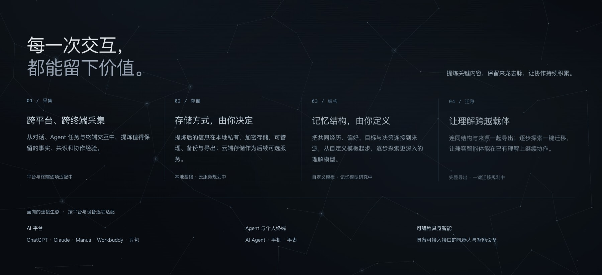

| Pillar | What it gives you | Design intent |
| --- | --- | --- |
| **Capture** | Bring useful conversations, tasks and materials into one place | Set up a connection once, then save with a short request or a simple action |
| **Own** | Manage memory, backups and exports in your own Vault | Make storage, processing choices and access visible and controllable |
| **Structure** | Organize experiences, preferences, goals and decisions with their evidence | Preserve context, time, uncertainty and corrections as the structure develops |
| **Move** | Carry relevant understanding into another AI or task | Connect tools to a shared memory store or select a one-time context pack |

**Capture → preserve the original → clean and structure → organize → use within scope → revise.**

For example, “During the Atlas launch phase, schedule weekday team meetings after 14:00, except for urgent incidents.” A useful memory carries the preference, its project phase and its exception. When circumstances change, revise the memory and retain its previous version and reasoning.

## How memory structure can grow

**NMM · Nova Memory Model** is the research codename for Nova's memory structure work. It explores how episodes, claims, goals and decisions can form traceable, revisable and evolving understanding.


The product organizes this work into three layers.

| Layer | What it preserves or organizes | Value for future collaboration |
| --- | --- | --- |
| **Original materials** | Original words, platform, role, time and capture records | Return to what was actually expressed |
| **Structured memory** | Objects, statements, conditions, time, evidence and versions | Find and apply a memory in its appropriate context |
| **Ongoing understanding** | Project and topic Wiki views, consolidation and supported relationships | Assemble scattered materials into context that can be improved |

Some foundations need to remain dependable as the structure evolves.

- **Provenance.** Trace a statement back to its supporting material.
- **Context.** Retain the project, phase, exceptions and scope.
- **Time.** Distinguish when something was recorded, when it applied and how it changed.
- **Uncertainty.** Keep unknowns, inferences and unfinished goals identifiable.
- **Revision.** Preserve previous versions and the reason for a correction.
- **Use boundaries.** Evaluate the recipient and scope against the current authorization.

Six connected research perspectives extend this foundation.

<p align="center">
  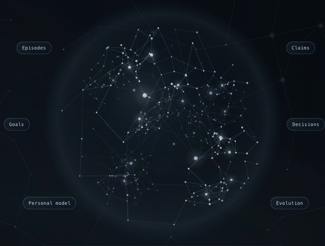
</p>

| Perspective | The question it explores |
| --- | --- |
| **Episodes** | What happened, who took part and what was the original context? |
| **Claims** | What was stated, under which conditions and with which supporting or conflicting evidence? |
| **Goals** | What is the intended outcome, what constrains it and what establishes completion? |
| **Decisions** | Which trade-offs were made, why and what was learned from the outcome? |
| **Personal model** | Which preferences and collaboration patterns recur, and where are their exceptions? |
| **Evolution** | How should new information revise earlier understanding? |

The current product includes structured records, provenance, versions, Wiki views and graph projections. Deeper personal models, complex relationships and cross-device projections remain research directions to validate through use.

<details>
<summary>Explore the website's structure and evolution concepts</summary>

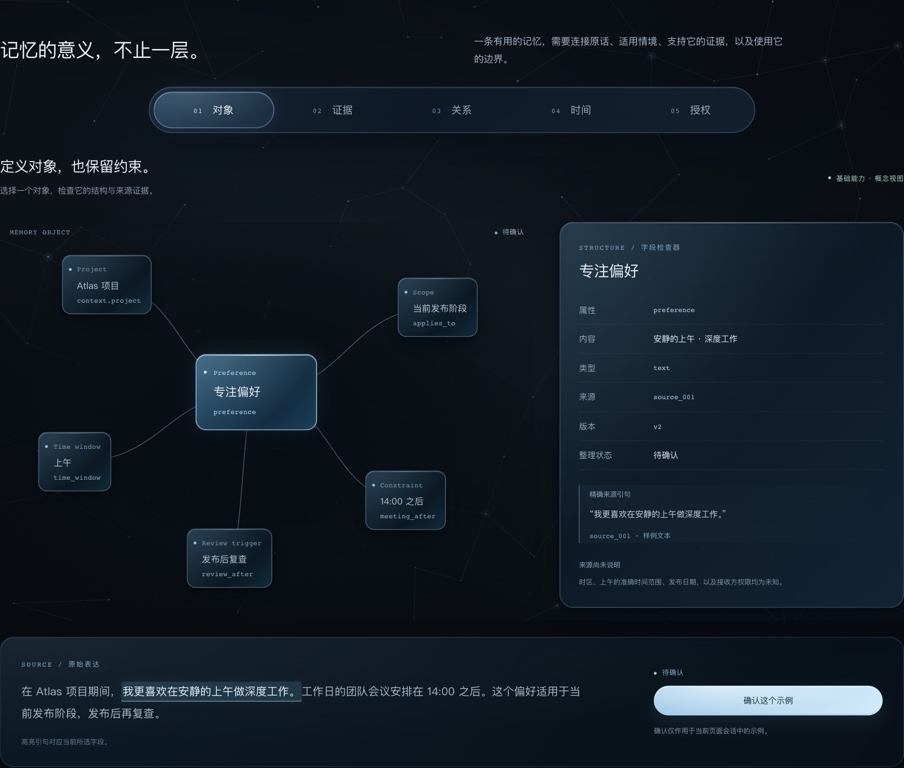

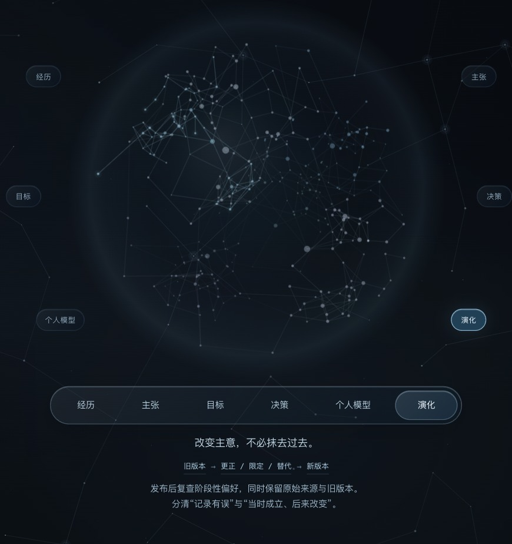

</details>

## Memory under your control


**Choose what stays.** Inspect, edit, correct and delete saved material, while keeping the state of originals and derived understanding clear.

**Decide who can use it.** Manage capture and reading permissions separately, inspect disclosures and revoke future access.

**Carry the context with you.** Manage memory alongside its sources, structure and history, with context sharing and encrypted-backup inspection paths.

The local Vault uses encrypted storage. You choose the model and processing settings. When using a remote model or AI connection, the relevant content is sent to the configured destination according to those settings.

## Connect the AI tools you use

The current focus is **ChatGPT, Codex, Claude, WorkBuddy, Grok and Cursor**, using MCP, platform connectors and suitable lifecycle hooks. Client variants, entry points and authentication are tracked separately.

| Platform | Connection path | Current evidence or setup boundary |
| --- | --- | --- |
| **Cursor** | Local MCP configuration, capture, retrieval and task continuity | Actual IDE new-session, correction and reauthorization records |
| **Codex** | Explicit MCP save/read, optional CLI capture hooks | Actual CLI tool-call and Hook ingestion, replay and revocation records |
| **Claude** | Local MCP configuration for Claude Code | Actual Code client save/read records; chat and Desktop require their own verification |
| **WorkBuddy** | User-level MCP configuration | Actual client save/read records; project-level configuration is checked separately |
| **ChatGPT** | Remote MCP gateway and authenticated tunnel | Requires a reachable endpoint and account-specific setup |
| **Grok** | Custom MCP connector at grok.com | Public reachability and account authentication compatibility remain under individual verification |

The workbench supplies instructions for the selected platform. Other MCP-compatible clients can be adapted through the standard interface. Automatic capture is expanded platform by platform; Codex CLI currently has actual Hook records.

## The long-term vision

**Familiar understanding, across different forms.**

Building on that starting point, we want people to retain the understanding developed through shared experience and carry it into the AI systems, agents and programmable devices they choose. Familiar context, preferences and the reasons behind decisions can develop with new tasks and be revised as circumstances change.

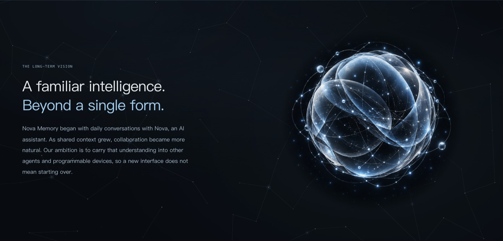

The immediate focus is a complete, smooth local experience. Open-source use and feedback will guide improvements to capture, management and cross-AI collaboration, alongside continuing research into memory structure. Personal cloud services, device coordination and deeper personal modeling will progress with demand and validation.

## Build it with us

Nova Memory is created and maintained by Evan as an independent Atom Awareness product.

- [Share a problem or product idea](https://github.com/JayeeeJY/nova-memory/issues).
- Read [CONTRIBUTING.md](CONTRIBUTING.md) to work on capture adapters, the workbench, memory structure or connections.
- [Star and follow the repository](https://github.com/JayeeeJY/nova-memory) to keep up with the project.

Local-product code is licensed under [AGPL-3.0-only](LICENSE). Dependencies retain their licenses. See [LICENSE_SCOPE.md](LICENSE_SCOPE.md) for the software scope, branding and corresponding-source delivery.

Website imagery comes from the [Nova Memory website](https://nova-memory.atom-evan001.chatgpt.site/), whose current entry may require access permission. This page uses local renders of the same design source and an isolated synthetic workbench.

---

Nova Memory / **Powered by Atom Awareness**<br>
Independent AI Product & Research Studio · Make complexity perceivable.
