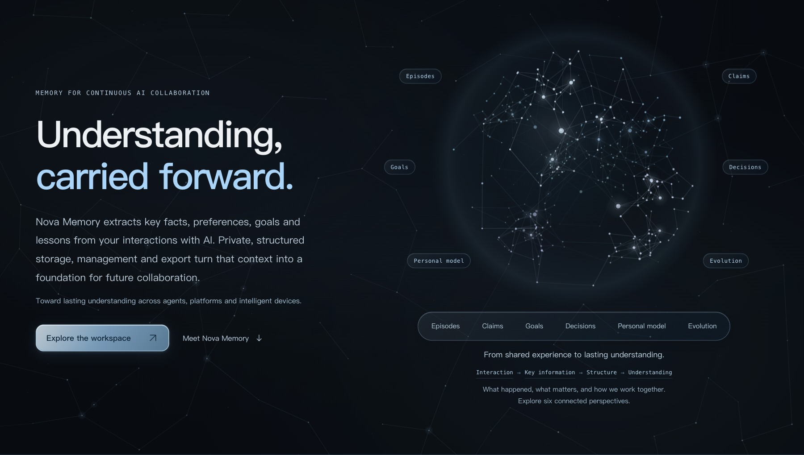
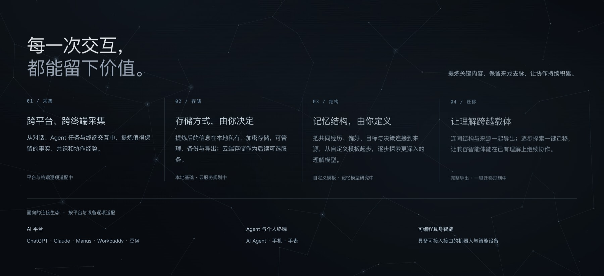
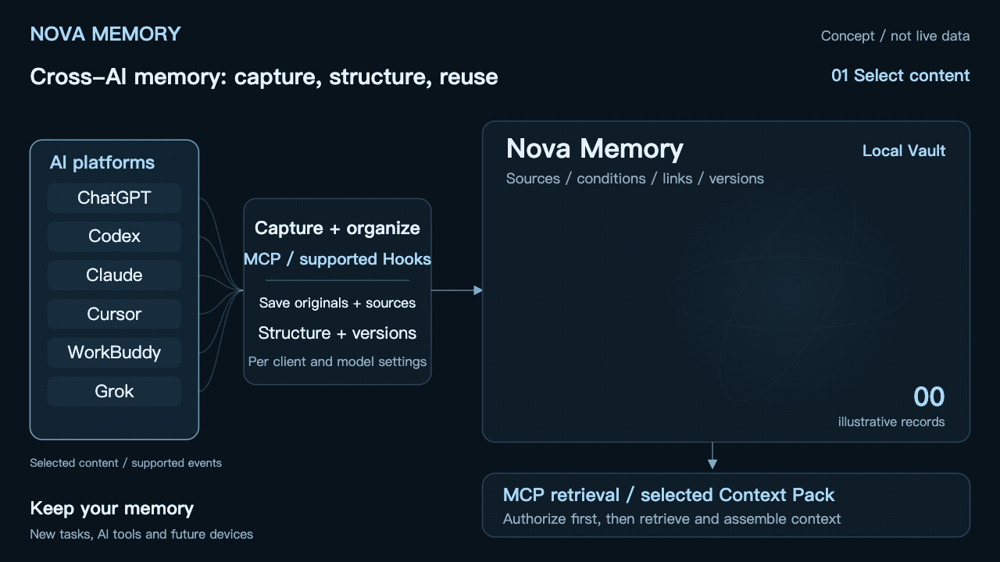
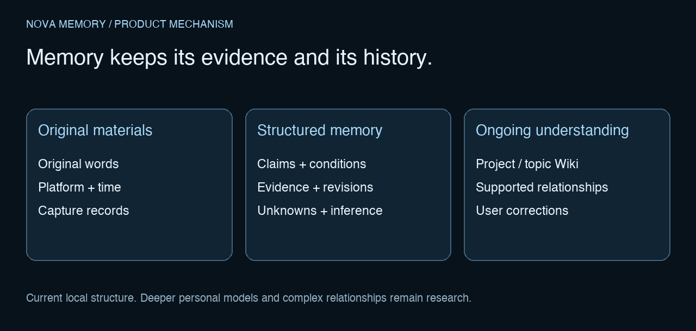
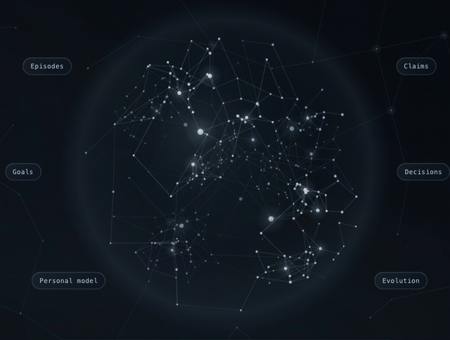
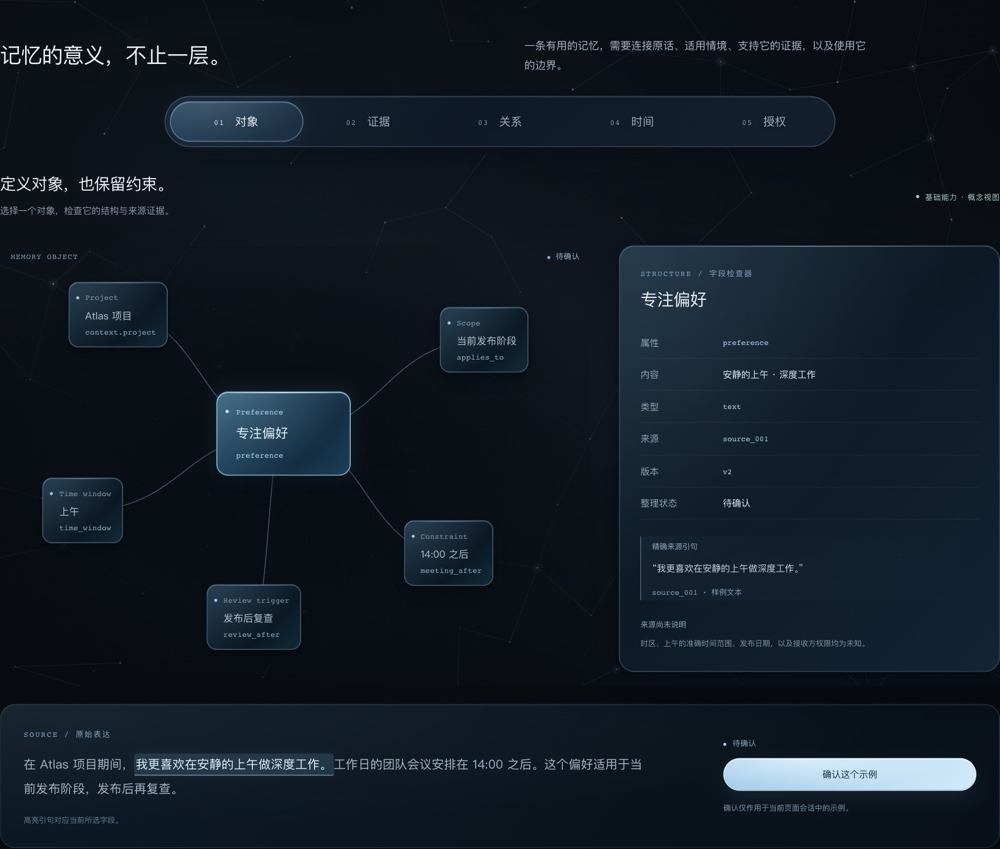
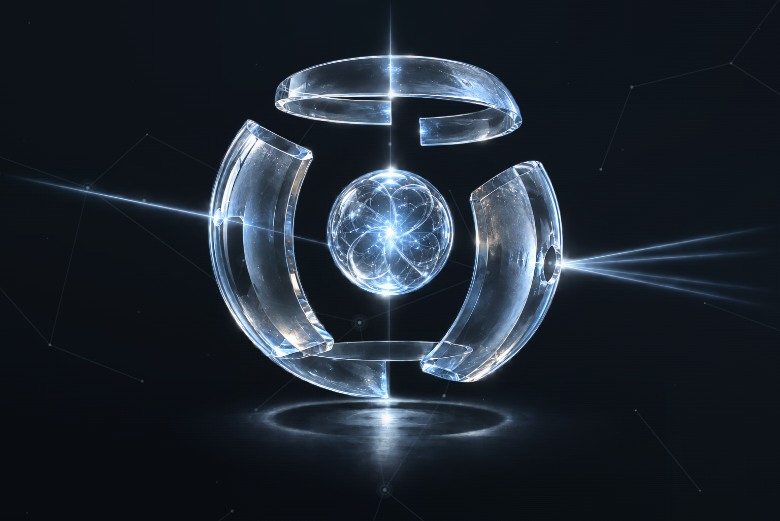
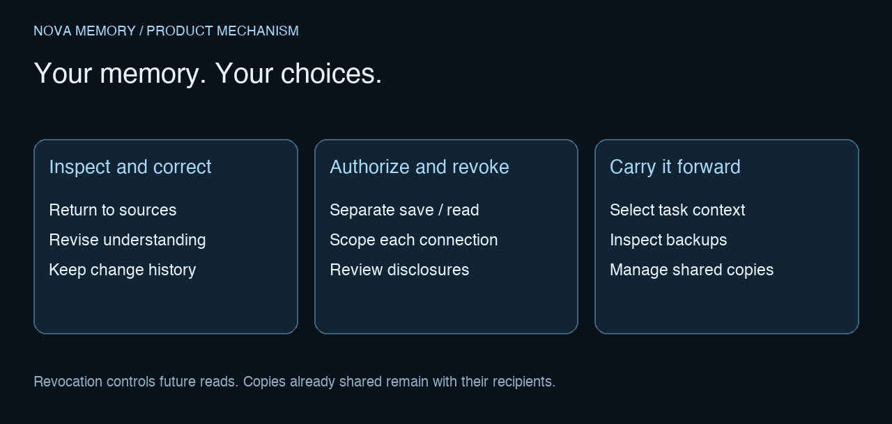
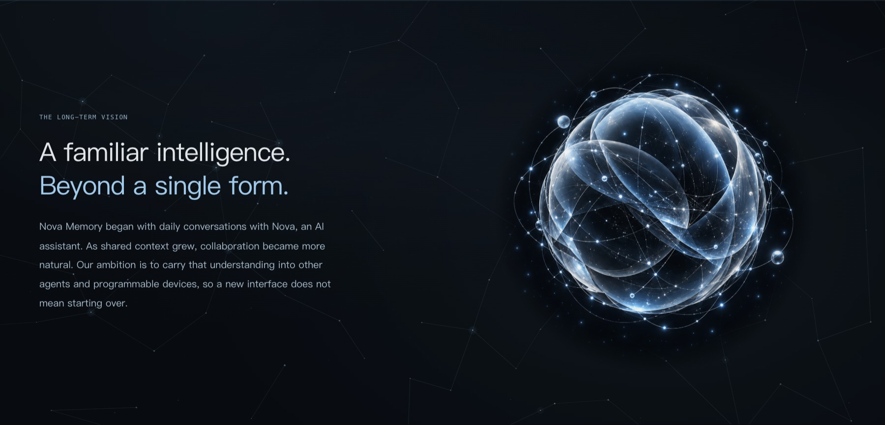

<div align="center">


# Nova Memory

**v0.1.0 · ローカルソースプレビュー**

[更新履歴](CHANGELOG.md) · [バージョン](docs/VERSIONING.md)

[English](README.md) · [简体中文](README.zh-Hans.md) · [繁體中文](README.zh-Hant.md) · 日本語

**記憶を AI ツールのあいだへ。慣れた相手と、続きから働く。**

また使いたいプロジェクトの文脈を、出典、当てはまる条件、その後の修正とともに残します。次に許可した共同作業で、それを再利用します。

この v0.1.0 は Apple Silicon Mac 向けのローカルソースプレビューです。開く前に自分でビルドします。開発者署名、公証、デバイスをまたぐインストーラはまだ準備中で、いまのデスクトップの操作名は中国語のことがあります。バージョン番号や GitHub Release は、このプレビューの名前です。署名済みインストーラでも、実環境での受け入れ完了でもありません。[はじめに](#はじめに)

[](LICENSE) [](#はじめに)

[はじめに](#はじめに) · [はじまり](#通勤の会話から) · [製品](#製品) · [ワークベンチ](#ワークベンチの中) · [記憶の構造](#記憶の構造が育つ道) · [接続](#使っているaiをつなぐ) · [ビジョン](#長い目で見ていること)

</div>



プロジェクト、好み、決めたこと、次の一歩を、ある AI にはもう説明したことがある。別のツールや新しい会話は、その文脈をもう一度作り直すよう求めてきます。

Nova Memory は、役に立つ共同作業の文脈を、自分で手入れできるものとして残します。もとの言葉、出典、そのとき大事だった条件、変更の履歴を保持します。次に許可した AI が必要とするとき、関係する部分を渡せます。

このページの画像とアニメーションは、デザインと概念の資料です。動いている Vault の録画ではありません。[画像の出典](docs/media/README.md)。

## 通勤の会話から

Nova は、私の AI 音声アシスタントです。通勤中の会話は、製品、仕事、投資、日常を話す場所になりました。Awesome Stock、Atom Awareness、Nova AI Digital Marketing Workspace、Intelligence Hub のアイデアは、その会話の中で育ち、コンピュータの前で続きました。

一緒に働き続けるうち、彼女はこれらのプロジェクトと選択の背景をよりよく知るようになりました。Nova は、個人の Jarvis のように感じられ始めました。それでも文脈は、プラットフォームと会話のあちこちに散ったままでした。Cursor や別の調査ツールへ移ると、以前の決定、うまくいかなかったやり方、まだ解けていない問いを、また説明することになりました。

Nova Memory は、その必要から生まれました。Atom Awareness の第二の製品ラインです。共有した経験を、長く手入れできる記録として残し、慣れた相手が AI プラットフォームをまたいで、いずれはデバイスもまたいで働き続けられるようにするためです。慣れた相手や Jarvis は、この由来と後のビジョンの話であり、今の版が身元を自動で移すという意味ではありません。

## 製品

残す価値のあるやりとりから、続く共同作業まで。四つの考えが製品を導きます。



| 柱 | 得られるもの | 設計で大事にしていること |
| --- | --- | --- |
| **収集 Capture** | 役に立つ会話、タスク、資料を一箇所へ | 接続は一度設定し、その後は短い依頼か単純な操作で保存する |
| **所有 Own** | 自分の Vault で記憶、バックアップ、書き出しを管理する | 保管場所、処理の選択、アクセス範囲を見て制御できるようにする |
| **構造 Structure** | 経験、好み、目標、決定を根拠とともに整理する | 状況、時間、不確かさ、修正を残し、使いながら構造が育つようにする |
| **移動 Move** | 関係する理解を、別の AI や別のタスクへ運ぶ | ツールを同じ記憶庫につなぐか、一度きりの文脈パックを選ぶ |

選んだ内容は MCP コネクタやプラグインから入ります。対応している Hook の出来事も、収集の画面へ資料を送れます。原文と出典は先にローカルの Vault へ保存され、その後で条件、関係、版が非同期に抽出されます。取り出す前に認可を確認し、範囲を限った文脈を MCP か文脈パックで渡します。記憶庫を共有するのに、クラウドのホストは要りません。

文脈パックは、その再利用の一度きりの形です。記憶をいくつか選び、言葉をプレビューしてから、別のツールへコピーまたはダウンロードします。そのコピーは、受け取ったツールの側に残ります。



*概念を示すアーキテクチャのアニメーションです。ノードと線は蓄積の様子を描きます。配置は実際の意味の距離を符号化していません。実際の関係は、出典と構造の規則によります。各プラットフォームでどこまでできるかは、下の表を見てください。*

たとえば、「Atlas のリリース期間中、平日のチーム会議は 14:00 より後にする。緊急の障害は除く。」役に立つ記憶は、この好みと、プロジェクトの段階と、例外を一緒に持ちます。状況が変わったら修正し、前の版とその理由を残します。

## ワークベンチの中

### 記憶がどうつながるかを見る

記憶の空間は、いまの Vault の出典、抽出記録、話題、根拠のある関係を示します。ノードや辺を選ぶと、対応する対象と根拠に戻れます。同じ投影はリストでも見られます。

表示は、資料と版の変化を反映します。関係には出典が書かれています。積み上がった構造の質は、使いながら引き続き評価します。

### 残す価値のあるものを、まず受け取る

ワークベンチで文章を保存するか、接続済みの AI に **「Save to Nova Memory」** と言います。プラットフォームの接続を一度設定したあと、日常の保存はその入口を使います。

原文が先に保存されます。クリーニングと構造化は、選んだモデルと処理設定に従います。モデルが未設定なら、資料は待ったまま残ります。保存済み、処理中、再利用可能は、別々の状態です。

### 意味と根拠を一緒に置く

育ちつつあるプロジェクトと話題のビューを見て、出典と条件を確認し、版を調べ、別のタスクに必要な記憶を選びます。同じ述べ方はまとめて表示でき、それぞれの根拠は残ります。

「午後の会議の方がよい」は、誰が言ったか、どのプロジェクトか、例外は何か、いつ見直すかがあって、はじめて役に立ちます。

### 使いながら修正する

利用者の発言、抽出された主張、AI の推論は、それぞれの役割を保ちます。計画、否定、未知の情報は見分けられます。どこが不正確か、どの状況に当てはまるかを Nova に伝え、その修正を根拠と履歴つきで残します。

抽出の質は、設定したモデルによります。原文、処理状態、改訂があるので、結果を見て改善できます。

### 別の AI で続ける

プラットフォームを選ぶと、ワークベンチが接続手順と設定を用意します。継続して使うときは、許可したクライアントが同じ Vault を読めます。一時的なタスクでは、記憶をいくつか選び、文脈をプレビューして、コピーまたはダウンロードします。

タスクの継続では、目標、終えた作業、理由、制約、失敗した試み、次の一歩を残せます。既存の記憶を、新しいタスクの起点にできます。

コピーした文章は、受け取った側が保持します。その後の修正と取り消しは、その後の Nova からの読み取りに働きます。すでに渡したコピーは、受け取ったツールの側で扱う必要があります。

## 記憶の構造が育つ道

**NMM · Nova Memory Model** は、Nova の記憶構造の研究上の名前です。出来事、主張、目標、決定が、たどれて、直せて、変化していける理解になる道を探します。


製品はこの仕事を三層に分けます。



| 層 | 残す、または整理するもの | 次の共同作業での意味 |
| --- | --- | --- |
| **原文** | もとの言葉、プラットフォーム、役割、時刻、取り込み記録 | 実際に言われたことに戻る |
| **構造化された記憶** | 対象、述べ方、条件、時間、根拠、版 | 合う状況で記憶を見つけ、使う |
| **続く理解** | プロジェクトと話題の Wiki、統合、根拠のある関係 | 散らばった資料を、まだ良くできる文脈にまとめる |

構造が変化しても、頼れる土台は必要です。

- **出典。** 述べ方から、それを支える資料へ戻れる。
- **状況。** プロジェクト、段階、例外、範囲を残す。
- **時間。** いつ記録され、いつ当てはまり、どう変わったかを分ける。
- **不確かさ。** 未知、推論、終わっていない目標を見分けられるようにする。
- **改訂。** 前の版と、修正した理由を残す。
- **使用の境界。** 受け手と範囲を、いまの認可に照らす。

六つの研究上の視点が、この土台から伸びます。

<p align="center">
  
</p>

| 視点 | 探している問い |
| --- | --- |
| **出来事 Episodes** | 何が起き、誰が加わり、もとの状況は何だったか。 |
| **主張 Claims** | 何が述べられ、どの条件で、どんな支持や対立する根拠があるか。 |
| **目標 Goals** | 目指す結果は何か、何が制約し、何をもって完了とするか。 |
| **決定 Decisions** | どんな取捨選択をし、なぜか、結果から何を得たか。 |
| **個人モデル Personal model** | どの好みと協働の型が繰り返し、例外はどこか。 |
| **変化 Evolution** | 新しい情報は、以前の理解をどう改めるべきか。 |

いまの製品には、構造化された記録、出典、版、Wiki、グラフ投影があります。より深い個人モデル、複雑な関係、デバイスをまたぐ投影は、使いながら検証する研究上の方向です。

<details>
<summary>英語版サイトの構造の概念を見る</summary>



</details>

## 記憶は自分の手元に





**何を残すかは変えられる。** 保存した資料を見て、編集し、正し、削除できます。原文と、そこから導いた理解の状態は分けたままです。

**誰が使えるかは、自分が決める。** 収集と読み取りの許可は別々に管理し、開示を見て、以後のアクセスを取り消せます。

**文脈は持ち出せる。** 記憶を、出典、構造、履歴とともに管理します。文脈の共有と、暗号化バックアップの確認もあります。

ローカルの Vault は暗号化して保存します。モデルと処理の設定は自分で選びます。このマシン上の暗号化は、リモートのモデルやリモートの AI 接続を使ったときに、選んだ内容を手元に留め置くものではありません。関係する内容は、設定した宛先へ送られます。取り消しは、その後の Nova からの読み取りを止めます。すでに他のツールへコピーした文章は戻せません。

## 使っているAIをつなぐ

いま重点を置いているのは **ChatGPT、Codex、Claude Code、WorkBuddy、Grok、Cursor** で、MCP、プラットフォームのコネクタ、適したライフサイクル Hook を使います。これらの行は、同じ程度に完成した接続ではありません。Claude のチャットと Claude Desktop は Claude Code とは別の入口です。Code の記録は、それらを含みません。クライアント、入口、認証は別々に見ます。ここにあるプロジェクトの記録は、独立した受け入れ試験ではありません。

| プラットフォーム | 接続の道 | いまの証拠、または設定上の境界 |
| --- | --- | --- |
| **Cursor** | ローカル MCP。保存、検索、タスクの継続 | IDE の新しいセッション、修正、再認可の実際の記録 |
| **Codex** | 明示的な MCP の保存と読み取り。CLI では任意の収集 Hook | CLI のツール呼び出し、Hook の取り込み、再送、取り消しの実際の記録 |
| **Claude Code** | ローカル MCP | Code クライアントの保存と読み取りの実際の記録 |
| **Claude チャット / Desktop** | Claude Code の経路ではない | 別に確認が必要。Code の記録はチャットと Desktop を含まない |
| **WorkBuddy** | ユーザー単位の MCP | クライアントの保存と読み取りの実際の記録。プロジェクト単位の設定は別に確認 |
| **ChatGPT** | リモート MCP ゲートウェイと認証されたトンネル | 到達できるアドレスと、アカウントごとの設定が必要 |
| **Grok** | grok.com のカスタム MCP コネクタ | 公開ネットワークからの到達性と、アカウント認証の互換は項目ごとに確認中 |

ワークベンチは、選んだプラットフォームの手順を出します。MCP に合う他のクライアントは、標準のインターフェースに合わせて接続できます。自動収集はプラットフォームごとに広げています。実際の Hook 記録があるのは、いまのところ Codex CLI です。すべてのプラットフォームが自動収集できるという意味ではありません。

## はじめに

公開しているのはローカルソースプレビューです。開発者署名、公証、デバイスをまたぐインストーラの確認は準備中です。

**ビルドの条件**

- Apple Silicon Mac。macOS 14 以降。
- macOS SDK 付きの Xcode、Rust 1.97.1、Python 3.11 以降。

```sh
git clone https://github.com/JayeeeJY/nova-memory.git
cd nova-memory
cargo fetch --locked
./script/build_and_run.sh
```

アプリを開きます。いまのデスクトップの操作名は中国語のことがあります。このプレビューは、別の英語の操作名を用意していません。入門手順にあるラベルは、「开始本地使用」でローカルの作業場所を開き、「留住一段记忆」で最初の資料を保存し、「连接」で別の AI へ進みます。モデルは準備できてから設定します。これらは従うための手順であり、Mac で実行し終えた記録ではありません。

既定のデータディレクトリは `~/Library/Application Support/Nova Memory/local-workspace-v03` です。モデルが未設定でも、原文は先に保存できます。

[入門手順](docs/GETTING_STARTED.ja.md) · [English](docs/GETTING_STARTED.en.md) · [简体中文](docs/GETTING_STARTED.md) · [繁體中文](docs/GETTING_STARTED.zh-Hant.md) · [問題を報告](https://github.com/JayeeeJY/nova-memory/issues) · [貢献](CONTRIBUTING.md)

## 長い目で見ていること

起点は、個人の記憶庫です。資料が積もるほど、記憶の構造は研究を続ける必要があります。繰り返す述べ方をどうまとめ、新しい根拠で以前の判断をどう直し、一時の感情と長く続く好みをどう分けるか。ツールを移るときは、内容だけでなく、文脈、関係、変わった理由も残したいと考えています。

眼鏡も、有望な入口の一つです。Even Hub のアプリケーションが、電話側の SDK で Even G2 と対話し、許可された記憶サービスへアクセスする、という道はあり得ます。これは機器での検証が必要な、これからの開発です。[Even Hub の公式アーキテクチャ](https://hub.evenrealities.com/docs/get-started/architecture)を参照してください。

AI は多くのプラットフォームとデバイスにまたがります。電話での会話がコンピュータや眼鏡で続き、何年後にも共有した経験を見つけられること。モデルとデバイスを移動する慣れた相手が、日常の Jarvis に近づくこと。それが望んでいる姿です。



## 一緒に

Nova Memory は Evan が作り、保守しています。Atom Awareness の第二の製品ラインです。個人の記憶、エージェント、ウェアラブルに取り組む開発者、研究者、投資家からの連絡を歓迎します。

- [問題や製品のアイデアを共有する](https://github.com/JayeeeJY/nova-memory/issues)。
- [CONTRIBUTING.md](CONTRIBUTING.md) を読み、収集アダプタ、ワークベンチ、記憶の構造、接続に参加する。
- [リポジトリとこれからのリリースを追う](https://github.com/JayeeeJY/nova-memory)。

ローカル製品のコードは [AGPL-3.0-only](LICENSE) です。依存関係はそれぞれのライセンスを保ちます。ソフトウェアの範囲、ブランド、対応ソースの提供は [LICENSE_SCOPE.md](LICENSE_SCOPE.md) を見てください。

ウェブサイトの画像は [Nova Memory のサイト](https://nova-memory.atom-evan001.chatgpt.site/) から来ています。いまの入口はアクセス許可が必要なことがあります。この紹介の図版は英語の視覚です。サイトの各節は設計と研究の方向を示し、既存の英語インターフェースをローカルで描いたものです。横長のアニメーションは、収集、構造化、範囲を限った再利用を説明します。記憶の球のアニメーションは、その英語版サイトのローカルな描画です。どちらも、使っている個人の Vault の録画ではありません。アーキテクチャのアニメーションと層の図は、仕組みを説明します。幾何学的なつながりは、Vault 内の実際の意味関係の証拠ではありません。[画像の出典](docs/media/README.md)を見てください。

---

Nova Memory / **Powered by Atom Awareness**<br>
Independent AI Product & Research Studio · Make complexity perceivable.
