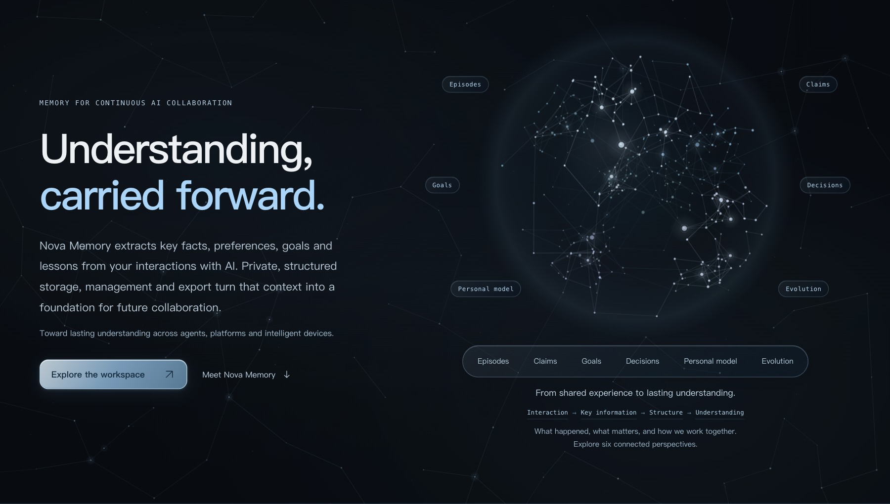
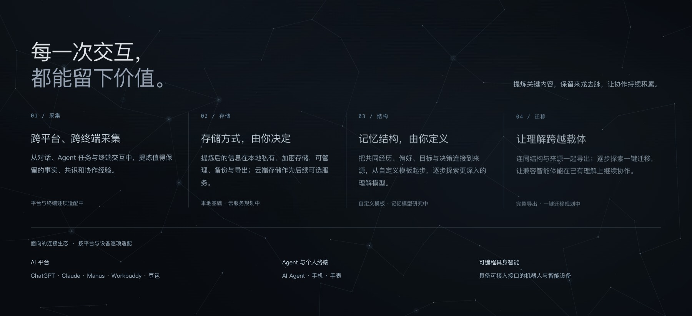
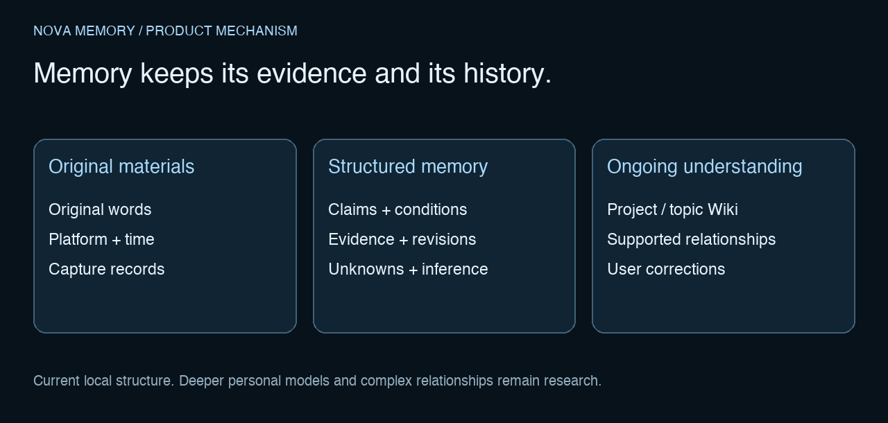
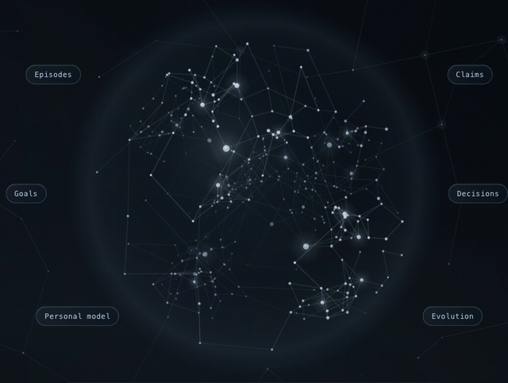
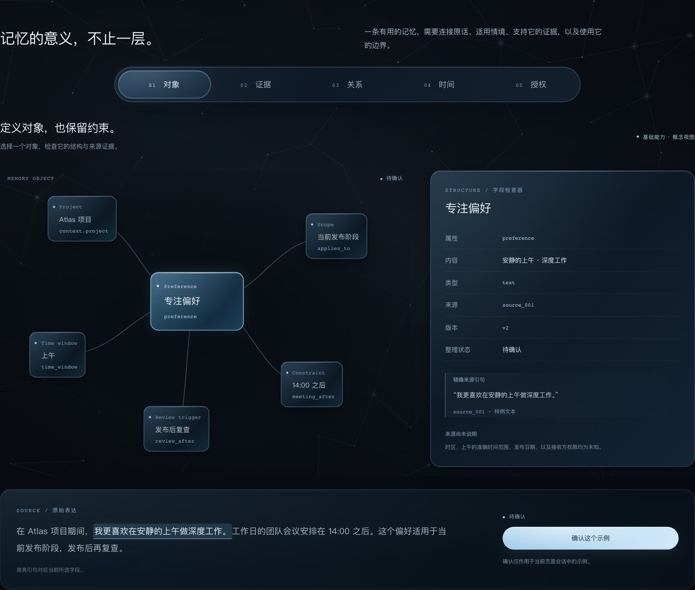
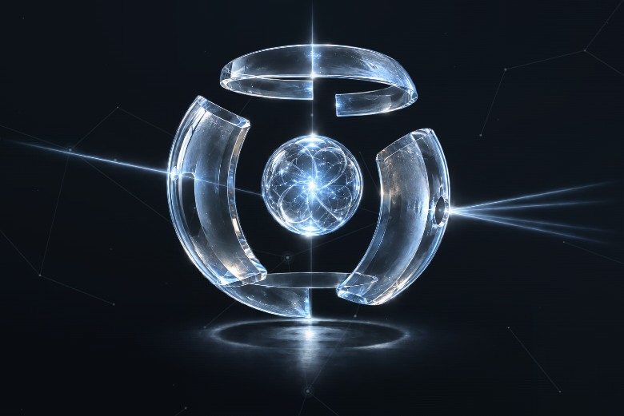
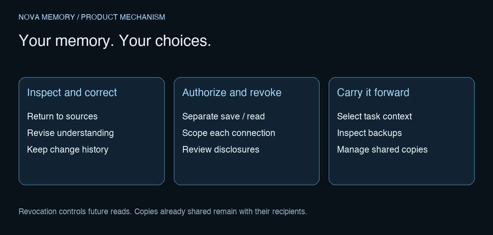
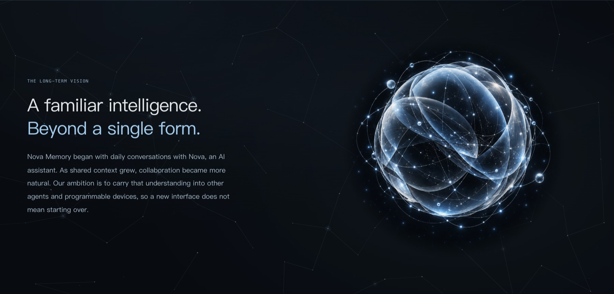

<div align="center">


# Nova Memory

<!-- nova-product-version --> **v0.1.0 · Local source preview**

[Changelog](CHANGELOG.md) · [Versioning](docs/VERSIONING.md)

English · [简体中文](README.zh-Hans.md) · [繁體中文](README.zh-Hant.md) · [日本語](README.ja.md)

**Bring memory across AI tools. Keep working with a familiar companion.**

Save project context you may need again, with its sources, the conditions it applies to, and later corrections. Reuse it in the next collaboration you authorize.

This v0.1.0 line is a local source preview for Apple Silicon Macs. Build it locally before opening the app. Signing, notarization and cross-device installer validation are still being prepared, and the current desktop controls may be in Chinese. A version or GitHub release names this preview; it is not itself a signed installer or a completed real-world acceptance. [Get started](#get-started)

[](LICENSE) [](#get-started)

[Get started](#get-started) · [Origins](#it-started-with-conversations-on-my-commute) · [Product](#the-product) · [Workbench](#inside-the-workbench) · [Memory structure](#how-memory-structure-can-grow) · [Connections](#connect-the-ai-tools-you-use) · [Vision](#the-long-term-vision)

</div>



You have already explained your project, preferences, decisions and next steps to one AI. A different tool or a new conversation often asks you to establish that context again.

Nova Memory turns useful collaboration context into a personal asset you can maintain. Keep the original words, their source, the conditions that matter and the history of a change. Let an authorized AI pick up the relevant context when it is useful again.

The images and animations on this page are concept and design material, not a recording of a live Vault. [Image provenance](docs/media/README.md).

## It started with conversations on my commute

Nova is my AI voice assistant. Conversations on my commute became a place to discuss products, work, investing and everyday life. Ideas for Awesome Stock, Atom Awareness, Nova AI Digital Marketing Workspace and Intelligence Hub developed through those conversations and continued at the computer.

As we kept working together, she became more familiar with the background to these projects and choices. Nova began to feel like a personal Jarvis. Yet the context remained scattered across platforms and conversations. Moving to Cursor or another research tool meant explaining earlier decisions, failed approaches and unresolved questions again.

Nova Memory grew from that need. It is Atom Awareness's second product line: keep a lasting, maintainable record of shared experience, so a familiar companion can continue working across AI platforms and, eventually, devices.

## The product

Four connected ideas guide the product, from an interaction worth keeping to an ongoing collaboration.



| Pillar | What it gives you | Design intent |
| --- | --- | --- |
| **Capture** | Bring useful conversations, tasks and materials into one place | Set up a connection once, then save with a short request or a simple action |
| **Own** | Manage memory, backups and exports in your own Vault | Make storage, processing choices and access visible and controllable |
| **Structure** | Organize experiences, preferences, goals and decisions with their evidence | Preserve context, time, uncertainty and corrections as the structure develops |
| **Move** | Carry relevant understanding into another AI or task | Connect tools to a shared memory store or select a one-time context pack |

Selected content arrives through MCP connectors or plugins; supported Hook events can also send material to the capture interface. Originals and provenance are stored in the local Vault before asynchronous extraction of conditions, relationships and versions. Authorization is checked before retrieval, then scoped context is delivered through MCP or a context pack. A shared memory store does not require cloud hosting.

A context pack is the one-time form of that reuse. You choose a few memories, preview the words, then copy or download them into another tool. That tool keeps the copy.


*Conceptual architecture animation. Nodes and links illustrate accumulation; geometry does not encode real semantic distance. Actual relationships depend on provenance and structure rules. Platform availability is listed below.*

For example, “During the Atlas launch phase, schedule weekday team meetings after 14:00, except for urgent incidents.” A useful memory carries the preference, its project phase and its exception. When circumstances change, revise the memory and retain its previous version and reasoning.

## Inside the workbench

### See how memory connects

The memory space visualizes the current Vault's sources, extraction records, topics and supported relationships. Select a node or an edge to return to its underlying object and evidence. A corresponding list provides another way to inspect the same projection.

The view reflects changes in the stored materials and versions. Its relationships have stated origins, while the quality of the accumulated structure continues to be evaluated through use.

### Capture with little ceremony

Save text in the workbench, or say **“Save to Nova Memory”** in a connected AI. Once the platform connection is configured, daily capture uses that existing entry point.

The original is saved first. Cleaning and structuring follow the selected model and processing settings. If a model has yet to be configured, the material remains available while it waits. Saved, processing and reusable states are shown separately.

### Keep the meaning and its evidence together

Browse evolving project and topic views, inspect sources and conditions, examine versions and select relevant memories for another task. Matching statements can be displayed together while retaining their supporting sources.

A meeting preference is more useful when you can also see who expressed it, which project it applies to, its exceptions and when to reconsider it.

### Correct the understanding as you go

User statements, extracted claims and AI inferences retain their roles. Plans, negation and unknown information remain distinguishable. Tell Nova what is inaccurate or which circumstances a statement applies to, and preserve the correction with its evidence and history.

Extraction quality depends on the configured model. Originals, processing status and revisions give you a way to inspect and improve the result.

### Continue in another AI

Choose a platform and the workbench prepares the appropriate connection steps and configuration. For ongoing use, authorized clients can read from the same Vault. For a temporary task, choose a few memories, preview their context and copy or download it.

Task continuity can preserve the goal, completed work, rationale, constraints, failed attempts and next steps. An existing memory can become the starting point for a new task.

A text copy is retained by its recipient. Later corrections and revocation control subsequent Nova reads; copies already shared need to be managed in the receiving tool.

## How memory structure can grow

**NMM · Nova Memory Model** is the research codename for Nova's memory structure work. It explores how episodes, claims, goals and decisions can form traceable, revisable and evolving understanding.


The product organizes this work into three layers.



| Layer | What it preserves or organizes | Value for future collaboration |
| --- | --- | --- |
| **Original materials** | Original words, platform, role, time and capture records | Return to what was actually expressed |
| **Structured memory** | Objects, statements, conditions, time, evidence and versions | Find and apply a memory in its appropriate context |
| **Ongoing understanding** | Project and topic Wiki views, consolidation and supported relationships | Assemble scattered materials into context that can be improved |

Some foundations need to remain dependable as the structure evolves.

- **Provenance.** Trace a statement back to its supporting material.
- **Context.** Retain the project, phase, exceptions and scope.
- **Time.** Distinguish when something was recorded, when it applied and how it changed.
- **Uncertainty.** Keep unknowns, inferences and unfinished goals identifiable.
- **Revision.** Preserve previous versions and the reason for a correction.
- **Use boundaries.** Evaluate the recipient and scope against the current authorization.

Six connected research perspectives extend this foundation.

<p align="center">
  
</p>

| Perspective | The question it explores |
| --- | --- |
| **Episodes** | What happened, who took part and what was the original context? |
| **Claims** | What was stated, under which conditions and with which supporting or conflicting evidence? |
| **Goals** | What is the intended outcome, what constrains it and what establishes completion? |
| **Decisions** | Which trade-offs were made, why and what was learned from the outcome? |
| **Personal model** | Which preferences and collaboration patterns recur, and where are their exceptions? |
| **Evolution** | How should new information revise earlier understanding? |

The current product includes structured records, provenance, versions, Wiki views and graph projections. Deeper personal models, complex relationships and cross-device projections remain research directions to validate through use.

<details>
<summary>Explore the English website structure concept</summary>



</details>

## Memory under your control





**Choose what stays.** Inspect, edit, correct and delete saved material, while keeping the state of originals and derived understanding clear.

**Decide who can use it.** Manage capture and reading permissions separately, inspect disclosures and revoke future access.

**Carry the context with you.** Manage memory alongside its sources, structure and history, with context sharing and encrypted-backup inspection paths.

The local Vault uses encrypted storage. You choose the model and processing settings. Encryption on this machine does not keep selected material local once you use a remote model or a remote AI connection: the relevant content is sent to the configured destination. Revoking access stops later Nova reads. It does not bring back text already copied into another tool.

## Connect the AI tools you use

The current focus includes **ChatGPT, Codex, Claude Code, WorkBuddy, Grok and Cursor**, using MCP, platform connectors and suitable lifecycle hooks. These rows are not equally finished integrations. Claude chat and Claude Desktop are separate from Claude Code; a Code record does not cover them. Client, entry point and authentication stay separate, and a project record here is not an independent acceptance.

| Platform | Connection path | Current evidence or setup boundary |
| --- | --- | --- |
| **Cursor** | Local MCP configuration, capture, retrieval and task continuity | Actual IDE new-session, correction and reauthorization records |
| **Codex** | Explicit MCP save/read, optional CLI capture hooks | Actual CLI tool-call and Hook ingestion, replay and revocation records |
| **Claude Code** | Local MCP configuration | Actual Code client save/read records |
| **Claude chat / Desktop** | Not the Claude Code path | Needs its own verification; Code records do not cover chat or Desktop |
| **WorkBuddy** | User-level MCP configuration | Actual client save/read records; project-level configuration is checked separately |
| **ChatGPT** | Remote MCP gateway and authenticated tunnel | Requires a reachable endpoint and account-specific setup |
| **Grok** | Custom MCP connector at grok.com | Public reachability and account authentication compatibility remain under individual verification |

The workbench supplies instructions for the selected platform. Other MCP-compatible clients can be adapted through the standard interface. Automatic capture is expanded platform by platform; Codex CLI currently has actual Hook records.

## Get started

The public delivery is a local source preview. Developer ID signing, notarization and cross-device installer validation are being prepared.

**Build prerequisites**

- Apple Silicon Mac running macOS 14 or later.
- Xcode with the macOS SDK, Rust 1.97.1 and Python 3.11 or later.

```sh
git clone https://github.com/JayeeeJY/nova-memory.git
cd nova-memory
cargo fetch --locked
./script/build_and_run.sh
```

Open the app. The current desktop controls may be displayed in Chinese; this preview does not document a separate English control set. The labels in the getting-started guide are 「开始本地使用」 to open a local workspace, 「留住一段记忆」 to save the first material, and 「连接」 for another AI. Configure a model when you are ready. Those steps are instructions to follow, not a record of a completed Mac run.

The default data directory is `~/Library/Application Support/Nova Memory/local-workspace-v03`. Original materials can be saved while model setup is pending.

[Full getting-started guide](docs/GETTING_STARTED.en.md) · [简体中文](docs/GETTING_STARTED.md) · [繁體中文](docs/GETTING_STARTED.zh-Hant.md) · [日本語](docs/GETTING_STARTED.ja.md) · [Report an issue](https://github.com/JayeeeJY/nova-memory/issues) · [Contribute](CONTRIBUTING.md)

## The long-term vision

The starting point is a personal memory library. As materials accumulate, memory structure needs continued research: how to consolidate repeated statements, revise earlier judgments with new evidence, and distinguish a passing emotion from a lasting preference. Moving between tools should preserve context, relationships and the reasons behind changes alongside the content.

Glasses are another promising entry point. An Even Hub application could use a phone-side SDK to interact with Even G2 and access an authorized memory service. This remains future development requiring device validation; see the [official Even Hub architecture](https://hub.evenrealities.com/docs/get-started/architecture).

AI will span many platforms and devices. We want a conversation on a phone to continue on a computer or glasses, and shared experiences to remain findable years later: a familiar companion that moves across models and devices, closer to a Jarvis in everyday life.



## Build it with us

Nova Memory is created and maintained by Evan as Atom Awareness's second product line. Developers, researchers and investors working on personal memory, agents and wearables are welcome to connect.

- [Share a problem or product idea](https://github.com/JayeeeJY/nova-memory/issues).
- Read [CONTRIBUTING.md](CONTRIBUTING.md) to contribute capture adapters, workbench improvements, memory structure or connections.
- [Follow the repository and future releases](https://github.com/JayeeeJY/nova-memory).

Local-product code is licensed under [AGPL-3.0-only](LICENSE). Dependencies retain their licenses. See [LICENSE_SCOPE.md](LICENSE_SCOPE.md) for the software scope, branding and corresponding-source delivery.

Website imagery comes from the [Nova Memory website](https://nova-memory.atom-evan001.chatgpt.site/), whose current entry may require access permission. This introduction and its visuals are in English. Website sections show the design and research direction and are local renders of the existing English interface. The horizontal animation explains capture, structuring and scoped reuse. The memory-sphere animation is a local render of that English website. Neither animation is a recording of a live personal Vault. The architecture animation and layer diagrams explain mechanisms. Geometric connections are not evidence of actual semantic relationships in a Vault. See the [image provenance](docs/media/README.md).

---

Nova Memory / **Powered by Atom Awareness**<br>
Independent AI Product & Research Studio · Make complexity perceivable.
