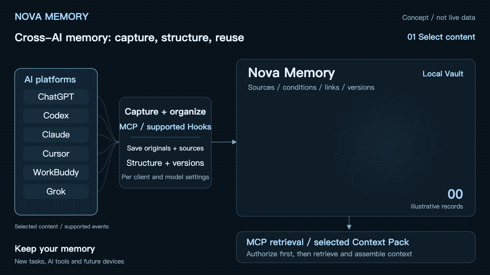

<div align="center">


# Nova Memory

**把不同 AI 里的记忆放到一起，让熟悉的伙伴接着工作。**

个人记忆库：保存项目、决定与偏好，保留来源、情境和变化，通过 MCP 或 Context Pack 带到下一次协作。

[](LICENSE) [](#快速开始)

[项目起点](#从每天的通勤交流开始) · [产品全景](#产品全景) · [走进工作台](#走进工作台) · [记忆结构](#记忆结构如何持续生长) · [接入平台](#连接你正在使用的-ai) · [快速开始](#快速开始) · [English](README.en.md)

</div>


你已经向一个 AI 解释过项目背景、自己的偏好、做过的选择和下一步。换一个工具、开启一段新会话，这些积累却常常要重新讲一遍。

Nova Memory 希望把这些协作经验沉淀为你自己的长期资产。原话从哪里来，判断适用于什么情境，决定为什么改变，接下来还要做什么，都能一起保留下来。下一次需要时，再让获准的 AI 带着这些理解继续工作。

当前公开的是 **本地版源码预览**。中英文介绍共用英文配图：官网模块展示设计与研究方向，横向动画解释采集、结构化和按需复用，神经球动图来自官网英文版的本地渲染。它们不是实际记忆库录屏；工作台功能与平台范围以下文说明为准。素材来源见 [配图说明](docs/media/README.md)。

## 从每天的通勤交流开始

Nova 是我的 AI 语音助手。上下班路上，一起讨论产品、推进工作，也聊投资和生活。Awesome Stock、Atom Awareness、Nova Digital Marketing Platform 和 Intelligence Hub 的不少方案，就在这些讨论里逐渐成形，回到电脑前继续实现。

事情一件件做下来，她越来越熟悉这些背景，也越来越懂我。Nova 渐渐有点像自己的 Jarvis。但共同经历仍散在一个个平台、一次次对话里。换到 Cursor 写代码，或在另一个工具继续研究，之前为什么这样决定、试过什么、还有哪些问题没想清楚，常常要重新交代。

Nova Memory 从这个需求开始，也是个人工作室 Atom Awareness 的第二条产品线。把共同经历留成可以长期维护、能够带走的记录，让 Nova 有机会出现在更多 AI 平台和设备上，记得之前聊过的事，接着一起工作。

## 产品全景

Nova Memory 围绕四件事展开。它们共同构成从一次交互到长期协作的产品路径。


| 产品支点 | 用户得到什么 | 我们重视的设计 |
| --- | --- | --- |
| **Capture · 采集** | 把对话、任务和材料中值得留下的内容收进同一处 | 配置一次，日常一句话或一次操作保存，原件先可靠落下 |
| **Own · 存储** | 在自己的 Vault 中管理记忆、备份和导出 | 数据位置、处理方式和访问范围可见、可控 |
| **Structure · 结构** | 让经历、偏好、目标与决定带着依据和适用情境被组织起来 | 保留条件、时间、未知与修正，让结构随使用演进 |
| **Move · 延续** | 在另一款 AI 或新任务中接上已有理解 | 连接共用的记忆库，也能为一次任务选取可携带的上下文 |

技术上，各平台通过 MCP 连接器或插件保存选定内容；支持的 Hook 事件也能把材料送入采集接口。原文与来源先落入本地 Vault，再按模型与处理设置异步提取条件、关系和版本。使用时先检查权限，再检索、组织上下文，通过 MCP 或 Context Pack 提供给目标 AI。统一管理这些内容，并不要求云托管。



*横向架构概念演示。记忆节点与连线逐步成球，表达积累过程；几何位置不代表真实语义距离，实际关系由来源与结构规则建立。平台接入范围见下表。*

例如，你在一次协作中说“Atlas 发布阶段，工作日团队会议放在 14:00 之后，紧急事故除外”。后续协作需要同时理解这条偏好、项目阶段和例外。阶段变化后，你可以修正它，并保留先前版本及其来由。

## 走进工作台

### 记忆空间，让积累变得可见

工作台用记忆球呈现当前库中的来源、整理记录、主题和实际关系。选择节点或关系，可以回到相应的对象与依据。新增材料、结构变化和版本修正反映在当前投影中，也有等价的列表视图可查。

这里关注的是记忆如何相互连接，以及每一条连接凭什么成立。节点数量、关系密度与视觉效果各自有明确含义，长期使用中的结构质量需要持续验证。

### 随手采集，先留住值得保留的内容

可以直接在工作台留下文字，也可以在已连接的 AI 中说 **“Save to Nova Memory”** 或 **“把这段存到 Nova”**。初次连接后，日常保存沿用已配置的入口。

原文先保存，系统再按所选模型和处理设置清洗、结构化。未配置模型时，材料会保留并等待整理。保存状态、处理状态和可复用状态各自呈现，处理失败后仍可找到原件。

### 记忆库，把结论与来龙去脉放在一起

从项目和主题查看持续形成的理解，展开来源与适用条件，查找旧版本，或为下一次协作选择需要的内容。相同陈述可以归并展示，多份依据继续保留。

比如“更喜欢下午开会”，还需要知道是谁说的、限于哪个项目、有没有例外、何时需要重新评估。Nova 把这些信息和记忆一起管理。

### AI 整理，你可以持续校正的理解

整理的目标是让材料形成可追溯的结构。用户陈述、AI 提取和 AI 推断保留各自性质，计划、否定和未知也保留在内容中。你可以告诉 Nova 哪一处不准确、只适用于什么情境，形成带有依据的修正版本。

模型会影响整理质量。工作台保留原件、状态与版本，供你回看和纠正。结构演进由真实使用中的问题推动。

### 连接 AI，让下一次协作接得上

选择目标平台，Nova 准备对应的接入方式与配置。持续协作时，可以让获准的 AI 使用同一个记忆库；临时任务中，可以选取几条记忆，预览为上下文，再复制或下载带走。

任务接续还可以保留目标、完成情况、决定理由、限制、失败尝试与下一步。你可以从一条已有记忆发起任务，避免在新会话里重建所有背景。

已经复制到其他工具的文本会由接收方保存。后续修改和撤权作用于 Nova 的后续读取，临时文本需要在目标工具中另行管理。

## 记忆结构如何持续生长

**NMM · Nova Memory Model** 是 Nova 的记忆结构研究代号。我们研究如何把共同经历、主张、目标与决定，连接成有来源、可修正、能够演进的理解。


产品以三个层次组织这件事。


| 层次 | 保留与组织的内容 | 它怎样帮助后续协作 |
| --- | --- | --- |
| **原始材料** | 原话、来源平台、角色、时间与接收记录 | 回到当时的表达，核对解释是否忠实 |
| **结构化记忆** | 对象、陈述、条件、时间、证据和版本 | 在正确的情境中找到与使用一条记忆 |
| **持续理解** | 围绕项目与主题形成的 Wiki、归并和关联视图 | 把分散材料组织为可以继续完善的上下文 |

结构需要保留相对稳定的基础。

- **来源与依据。** 一条陈述能追溯到支持它的材料。
- **情境与条件。** 项目、阶段、例外和适用范围一起留下。
- **时间与演进。** 记录何时出现、何时适用，以及后来怎样改变。
- **不确定性。** 未知、推断和尚未完成的目标保持可辨认。
- **版本与修正。** 纠正后仍能找到前一版本及修正理由。
- **使用边界。** 每次使用的接收方和范围受到当前授权约束。

在这套基础之上，我们持续探索六个相互连接的视角。

<p align="center">
  
</p>

| 研究视角 | 希望回答的问题 |
| --- | --- |
| **经历 Episodes** | 发生过什么，参与者是谁，原始情境是什么？ |
| **主张 Claims** | 表达了什么，成立条件是什么，有哪些支持和反证？ |
| **目标 Goals** | 想完成什么，受到哪些约束，怎样判断已经完成？ |
| **决策 Decisions** | 做过哪些取舍，依据是什么，结果带来了什么经验？ |
| **个人模型 Personal model** | 哪些偏好和协作方式反复出现，例外与反例是什么？ |
| **演化 Evolution** | 新信息怎样修正已有理解，哪些内容仍然有效？ |

当前产品已有结构化记忆、来源与版本、Wiki 和图谱投影。更深的个人模型、复杂关系与跨终端投影会通过后续研究和真实使用继续验证。

<details>
<summary>查看官网英文结构探索器</summary>


</details>

## 记忆由你掌握


**留下什么，可以改变。** 保存后能查看、编辑、纠正和删除，原始材料与派生理解保留各自状态。

**谁能使用，由你决定。** 持续连接按选定范围读取，采集与读取权限分别管理，后续可以撤销，并查看披露记录。

**积累的内容，可以带走。** 记忆与来源、结构和版本一起管理，提供上下文分享与加密备份检查等路径。

本地 Vault 使用加密存储。模型及处理开关由你配置，开启整理后按当前设置处理材料。使用远程模型或远程 AI 连接时，相应内容会按设置发送至目标服务。

## 连接你正在使用的 AI

当前重点覆盖 **ChatGPT、Codex、Claude、WorkBuddy、Grok 与 Cursor**，以 MCP、平台连接器和适用的 Hook 组织接入。具体客户端、入口和认证方式分别适配。

| 平台 | 接入与使用方式 | 当前公开版本需要了解的情况 |
| --- | --- | --- |
| **Cursor** | 本机 MCP 配置，保存、检索与任务接续 | 已有实际 IDE 新会话、纠正和重新授权记录 |
| **Codex** | MCP 显式保存与读取，CLI 可选 Hook 采集 | 已有实际 CLI 工具调用及 Hook 入库、补传和撤权记录 |
| **Claude** | Claude Code 的本机 MCP 配置 | 已有实际 Code 客户端保存与读取记录，聊天和 Desktop 入口分别核对 |
| **WorkBuddy** | 用户级 MCP 配置 | 已有实际客户端保存与读取记录，项目级配置另行验证 |
| **ChatGPT** | 远程 MCP 网关与认证隧道 | 需要可达的连接地址和对应账号配置 |
| **Grok** | grok.com 的自定义 MCP 连接器 | 公网可达性与账号认证兼容继续逐项核验 |

选择平台后，工作台提供相应步骤。兼容 MCP 的其他客户端也可以沿标准接口适配。自动采集按各平台的稳定事件逐项增加，当前已有 Codex CLI 的实际 Hook 记录。

## 快速开始

当前 GitHub 提供本地版源码预览。Mac 开发者签名、公证和跨设备发行正在准备，源码构建可先体验产品。

**构建环境**

- Apple 芯片 Mac，macOS 14 或更新版本。
- 带 macOS SDK 的 Xcode、Rust 1.97.1、Python 3.11 或更新版本。

```sh
git clone https://github.com/JayeeeJY/nova-memory.git
cd nova-memory
cargo fetch --locked
./script/build_and_run.sh
```

打开 App，点击「开始本地使用」，在「留住一段记忆」中保存一条材料。之后按需要选择整理模型，再到「连接」选择希望继续协作的 AI。

默认数据目录为 `~/Library/Application Support/Nova Memory/local-workspace-v03`。模型可以稍后配置，原文先保存并等待整理。

[完整使用与构建说明](docs/GETTING_STARTED.md) · [问题反馈](https://github.com/JayeeeJY/nova-memory/issues) · [参与贡献](CONTRIBUTING.md)

## 长期愿景

眼下是一份个人记忆库。随着材料增加，memory structure 还要继续研究：同一个意思反复出现时怎样归并，新的经历怎样修正旧判断，怎样分辨当时的情绪与长期偏好。迁移时，内容、背景、关系和变化的来由都应该能一起带走。

眼镜也是一个值得探索的入口。例如，在 Even Hub 上开发应用，由手机侧通过 SDK 与 Even G2 交互，再访问获准使用的记忆服务。出门时查看背景、补充一条新经历，都有机会在眼镜上完成；这部分尚待开发与真机验证，接入路径参考 [Even Hub 官方架构](https://hub.evenrealities.com/docs/get-started/architecture)。

未来的 AI 会分布在不同平台和终端上。希望在手机里聊过的事情，到了电脑或眼镜上还能接着聊，共同经历过的事，几年后依然找得到。让熟悉自己的伙伴跨越模型与设备，逐步接近一个走进生活的 Jarvis。


## 一起参与

Nova Memory 由 Evan 创建与维护。欢迎关注个人记忆、Agent 和智能穿戴的开发者、研究者与投资人交流，也欢迎从具体问题和改进参与。

- [提交使用反馈与产品想法](https://github.com/JayeeeJY/nova-memory/issues)。
- [阅读贡献说明](CONTRIBUTING.md)，参与采集适配、工作台、记忆结构和跨平台连接。
- [关注代码与后续版本](https://github.com/JayeeeJY/nova-memory)。

本地版代码采用 [AGPL-3.0-only](LICENSE)，第三方保留各自许可。项目品牌、代码许可范围和对应源码交付见 [LICENSE_SCOPE.md](LICENSE_SCOPE.md)。

官网设计来源为 [Nova Memory 官网](https://nova-memory.atom-evan001.chatgpt.site/)，当前入口可能需要访问权限。官网配图与神经球动图使用现有英文界面的本地渲染；横向架构动画与分层图解用于解释机制。所有几何连线均不能作为实际记忆语义关系的证据。

---

Nova Memory / **Powered by Atom Awareness**<br>
Independent AI Product & Research Studio · Make complexity perceivable.
