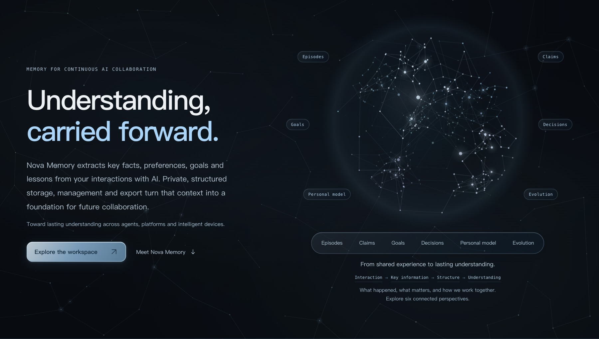
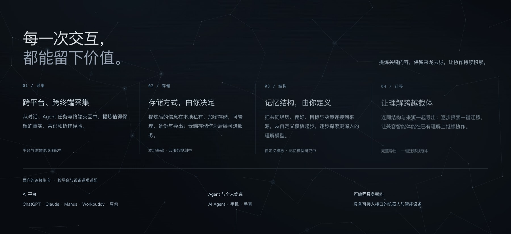
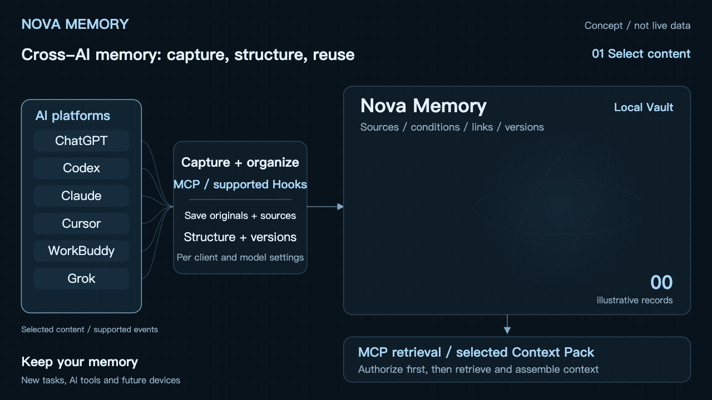
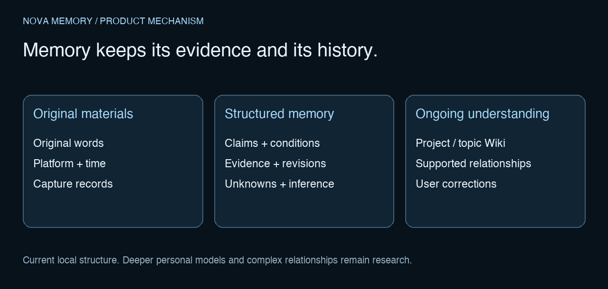
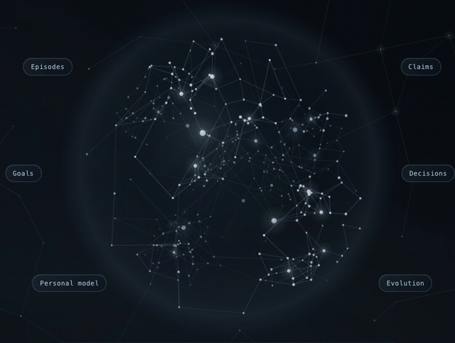
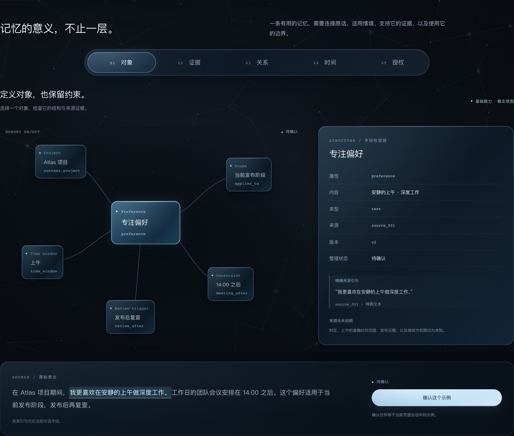
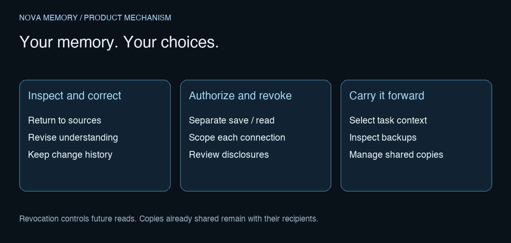
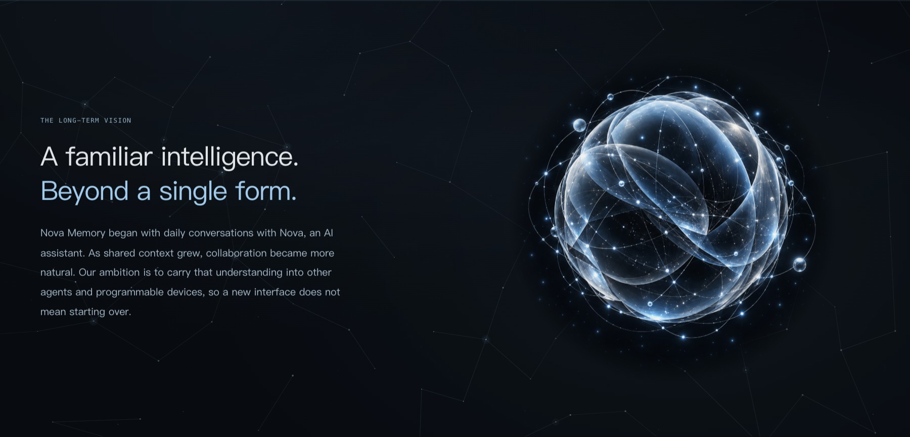

<div align="center">


# Nova Memory

**v0.1.0 · 本地源码预览**

[更新日志](CHANGELOG.md) · [版本说明](docs/VERSIONING.md)

[English](README.md) · 简体中文 · [繁體中文](README.zh-Hant.md) · [日本語](README.ja.md)

**把记忆带到不同的 AI 工具里。继续和熟悉的同伴一起工作。**

把以后还要用的项目上下文存下来，连同来源、适用条件和后来的修正。在你授权的下一次协作里继续使用。

这里的 v0.1.0 是 Apple 芯片 Mac 上的本地源码预览。打开之前需要自己构建。开发者签名、公证和跨设备安装包仍在准备，当前桌面控件可能是中文。版本号或 GitHub Release 只是给这次预览命名，本身不是签名安装包，也不是已经完成的真实环境验收。[快速开始](#快速开始)

[](LICENSE) [](#快速开始)

[快速开始](#快速开始) · [起点](#从通勤交谈开始) · [产品](#产品) · [工作台](#走进工作台) · [记忆结构](#记忆结构如何生长) · [连接](#连接正在使用的-ai) · [愿景](#长期愿景)

</div>



你已经向一个 AI 讲过项目、偏好、决定和下一步。换一个工具，或新开一段对话，这些背景常常又要再讲一遍。

Nova Memory 想把有用的协作上下文留成你可以自己维护的材料。原话、来源、当时重要的条件，以及后来的修改，都可以留下来。下一次获准的 AI 需要时，再带上相关的部分。

本页的图片和动画是设计与概念材料，不是一个正在使用的 Vault 的录屏。[配图说明](docs/media/README.md)。

## 从通勤交谈开始

Nova 是我的 AI 语音助手。上下班路上的交谈，变成讨论产品、工作、投资和日常生活的地方。Awesome Stock、Atom Awareness、Nova AI Digital Marketing Workspace 和 Intelligence Hub 的想法，都是在这些交谈里长出来，再回到电脑前继续的。

一直一起做下去之后，她更熟悉这些项目和选择的来龙去脉。Nova 开始像一个个人的 Jarvis。可上下文仍然散在不同平台和不同对话里。换到 Cursor 或其他研究工具时，又得把先前的决定、失败过的做法和还没解决的问题重新讲一遍。

Nova Memory 从这个需要里长出来。它是 Atom Awareness 的第二条产品线：把共同经历留成可以长期维护的记录，让熟悉的同伴能够跨 AI 平台继续工作，以后也有可能跨设备。熟悉的同伴和 Jarvis，是这段由来和后面的愿景，不是说当前版本会自动把一个身份搬过去。

## 产品

四件相连的事带着产品，从一次值得留下的交互，到持续的协作。



| 支点 | 你得到什么 | 设计上在意的事 |
| --- | --- | --- |
| **采集 Capture** | 把有用的对话、任务和材料收到一处 | 连接配置一次，之后用一句短请求或一个简单动作保存 |
| **拥有 Own** | 在自己的 Vault 里管理记忆、备份和导出 | 让存放位置、处理选择和访问范围看得见、控得住 |
| **结构 Structure** | 把经历、偏好、目标和决定连同依据组织起来 | 保留情境、时间、不确定和修正，让结构随着使用形成 |
| **迁移 Move** | 把相关理解带到另一个 AI 或另一项任务 | 让工具连到同一记忆库，或选出一份一次性上下文包 |

选中的内容经 MCP 连接器或插件进来；受支持的 Hook 事件也可以把材料送到采集界面。原件和来源先写入本地 Vault，再异步提取条件、关系和版本。读取前会检查授权，然后通过 MCP 或一份上下文包交付限定范围的内容。共用一个记忆库并不要求云托管。

上下文包就是这种复用的一次性形式。你选出几条记忆，先看文字，再复制或下载到另一个工具。那个工具会留下这份副本。



*概念架构动画。节点和连线表示积累；几何位置并不编码真实的语义距离。实际关系取决于来源和结构规则。各平台能做到哪一步，见下面的说明。*

例如：“Atlas 发布阶段，工作日的团队会议放在 14:00 之后，紧急事故除外。”一条有用的记忆要同时带着这个偏好、项目阶段和例外。情况变了，就修正它，并保留先前版本和理由。

## 走进工作台

### 看见记忆如何相连

记忆空间呈现当前 Vault 的来源、提取记录、主题和有依据的关系。选中一个节点或一条边，可以回到对应的对象和依据。同一投影也可以用列表查看。

视图会反映材料和版本的变化。关系写明了来源，而积累下来的结构质量仍要在使用中继续评估。

### 先把值得留下的内容收下

可以在工作台里保存文字，也可以在已连接的 AI 里说 **“Save to Nova Memory”**。平台连接配置好之后，日常保存就用这个已有入口。

原文先保存。清洗和结构化按所选模型和整理设置进行。还没配置模型时，材料会留着等待。已保存、处理中和可复用是分开的状态。

### 把意思和依据放在一起

按项目和主题浏览正在形成的理解，查看来源和条件，查看版本，并为另一项任务选出相关记忆。相同的说法可以放在一起显示，各自的依据仍然保留。

“更喜欢下午开会”只有在同时知道是谁说的、适用于哪个项目、有什么例外、何时再看一遍时，才比较有用。

### 一边用一边修正

用户陈述、提取出的主张和 AI 推断各自保留角色。计划、否定和未知信息保持可区分。告诉 Nova 哪里不准确，或一句话适用于什么情况，并让这次修正带着依据和历史留下来。

提取质量取决于所配置的模型。原件、处理状态和修订让你可以查看并改进结果。

### 在另一个 AI 里继续

选定平台后，工作台准备相应的连接步骤和配置。持续使用时，获准的客户端可以读取同一个 Vault。临时任务则选出几条记忆，预览上下文，再复制或下载。

任务接续可以保留目标、已完成的工作、理由、限制、失败过的尝试和下一步。一条已有记忆可以成为新任务的起点。

复制出去的文本由接收方保存。后来的修正和撤权只作用于之后的 Nova 读取；已经分享出去的副本需要在接收工具里另行管理。

## 记忆结构如何生长

**NMM · Nova Memory Model** 是 Nova 记忆结构研究的代号。它探索经历、主张、目标和决定怎样形成可追溯、可修订、能演进的理解。


产品把这件事分成三层。



| 层次 | 保留或组织的内容 | 对以后协作的用处 |
| --- | --- | --- |
| **原始材料** | 原话、平台、角色、时间和采集记录 | 回到当时实际说过的话 |
| **结构化记忆** | 对象、陈述、条件、时间、依据和版本 | 在合适的情境里找到并使用一条记忆 |
| **持续理解** | 项目与主题 Wiki、归并和有依据的关系 | 把散落的材料收成可以继续完善的上下文 |

结构演进时，有些基础需要保持可靠。

- **来源。** 一条陈述能追溯到支持它的材料。
- **情境。** 留下项目、阶段、例外和适用范围。
- **时间。** 区分何时记录、何时适用，以及后来如何改变。
- **不确定。** 让未知、推断和未完成的目标仍然认得出来。
- **修订。** 保留先前版本和修正理由。
- **使用边界。** 按当前授权衡量接收方和范围。

六个相连的研究视角在这个基础上展开。

<p align="center">
  
</p>

| 视角 | 它要探问的问题 |
| --- | --- |
| **经历 Episodes** | 发生过什么，谁参与，原来的情境是什么？ |
| **主张 Claims** | 说了什么，在什么条件下，有哪些支持或冲突的依据？ |
| **目标 Goals** | 想达到什么，受什么约束，怎样算完成？ |
| **决定 Decisions** | 做了哪些取舍，为什么，结果带来了什么经验？ |
| **个人模型 Personal model** | 哪些偏好和协作方式反复出现，例外在哪里？ |
| **演化 Evolution** | 新信息应该怎样修订先前的理解？ |

当前产品已有结构化记录、来源、版本、Wiki 和图谱投影。更深的个人模型、复杂关系和跨设备投影仍是要通过使用来验证的研究方向。

<details>
<summary>查看英文官网的结构概念</summary>



</details>

## 记忆由你掌握




**留下什么，可以改变。** 查看、编辑、纠正和删除已保存的材料，同时分清原件和派生理解的状态。

**谁能使用，由你决定。** 采集和读取权限分开管理，可以查看披露并撤销以后的访问。

**上下文可以带走。** 记忆与来源、结构和历史放在一起管理，并提供上下文分享和加密备份检查。

本地 Vault 使用加密存储。模型和整理开关由你选择。本机加密并不能在你使用远程模型或远程 AI 连接时把所选内容留在本地：相应内容会按设置发送到目标服务。撤权只停止以后的 Nova 读取，不能把已经复制到其他工具的文本收回来。

## 连接正在使用的 AI

当前重点包括 **ChatGPT、Codex、Claude Code、WorkBuddy、Grok 与 Cursor**，通过 MCP、平台连接器和适用的生命周期 Hook 组织。这些行并不是同样完成的接入。Claude 聊天和 Claude Desktop 与 Claude Code 是不同入口；Code 的记录不能代表它们。客户端、入口和认证分别看待，这里的项目记录也不是独立验收。

| 平台 | 接入路径 | 当前证据或设置边界 |
| --- | --- | --- |
| **Cursor** | 本机 MCP 配置，保存、检索与任务接续 | 已有 IDE 新会话、纠正和重新授权记录 |
| **Codex** | 显式 MCP 保存与读取，CLI 可选采集 Hook | 已有 CLI 工具调用及 Hook 入库、补传和撤权记录 |
| **Claude Code** | 本机 MCP 配置 | 已有 Code 客户端保存与读取记录 |
| **Claude 聊天 / Desktop** | 不是 Claude Code 那条路径 | 需要各自核对；Code 记录不覆盖聊天或 Desktop |
| **WorkBuddy** | 用户级 MCP 配置 | 已有客户端保存与读取记录；项目级配置另行核对 |
| **ChatGPT** | 远程 MCP 网关和认证隧道 | 需要可达的地址和对应账号配置 |
| **Grok** | grok.com 上的自定义 MCP 连接器 | 公网可达性和账号认证兼容仍逐项核对 |

工作台会给出所选平台的步骤。其他兼容 MCP 的客户端可以沿标准接口适配。自动采集按平台逐步增加；目前有实际 Hook 记录的是 Codex CLI。这不是所有平台都已自动采集。

## 快速开始

公开交付的是本地源码预览。开发者签名、公证和跨设备安装包检查仍在准备。

**构建条件**

- Apple 芯片 Mac，macOS 14 或更新版本。
- 带 macOS SDK 的 Xcode、Rust 1.97.1、Python 3.11 或更新版本。

```sh
git clone https://github.com/JayeeeJY/nova-memory.git
cd nova-memory
cargo fetch --locked
./script/build_and_run.sh
```

打开 App。当前桌面控件可能是中文；这份预览没有另写一套英文控件名称。入门说明里的标签是：「开始本地使用」打开本地工作区，「留住一段记忆」保存第一条材料，「连接」走向另一个 AI。准备好后再配置模型。这些是要照着做的说明，不是一次已经完成的 Mac 运行记录。

默认数据目录为 `~/Library/Application Support/Nova Memory/local-workspace-v03`。模型还没配好时，原文也可以先保存。

[完整入门说明](docs/GETTING_STARTED.md) · [English](docs/GETTING_STARTED.en.md) · [繁體中文](docs/GETTING_STARTED.zh-Hant.md) · [日本語](docs/GETTING_STARTED.ja.md) · [反馈问题](https://github.com/JayeeeJY/nova-memory/issues) · [参与贡献](CONTRIBUTING.md)

## 长期愿景

起点是一个个人记忆库。材料积累之后，记忆结构还需要继续研究：怎样归并重复的说法，怎样用新依据修订早先的判断，以及怎样区分一时的情绪和持久的偏好。在工具之间移动时，除了内容，上下文、关系和改变的理由也应留下来。

眼镜是另一个有希望的入口。一个 Even Hub 应用也许可以用手机侧 SDK 与 Even G2 交互，并访问获准的记忆服务。这仍是需要设备验证的未来开发；见 [Even Hub 官方架构](https://hub.evenrealities.com/docs/get-started/architecture)。

AI 会跨很多平台和设备。我们希望手机上的一段对话能在电脑或眼镜上继续，多年以后仍能找到共同经历：一个熟悉的同伴跨越模型和设备，更接近日常生活里的 Jarvis。



## 一起做

Nova Memory 由 Evan 创建并维护，是 Atom Awareness 的第二条产品线。做个人记忆、智能体和可穿戴设备的开发者、研究者和投资人，欢迎来联系。

- [提出问题或产品想法](https://github.com/JayeeeJY/nova-memory/issues)。
- 阅读 [CONTRIBUTING.md](CONTRIBUTING.md)，参与采集适配、工作台、记忆结构或连接。
- [关注仓库和以后的版本](https://github.com/JayeeeJY/nova-memory)。

本地产品代码采用 [AGPL-3.0-only](LICENSE)，依赖保留各自许可。软件范围、品牌和对应源码交付见 [LICENSE_SCOPE.md](LICENSE_SCOPE.md)。

官网图片来自 [Nova Memory 官网](https://nova-memory.atom-evan001.chatgpt.site/)，当前入口可能需要访问权限。本介绍的配图使用英文视觉。官网各段展示的是设计与研究方向，是现有英文界面的本地渲染。横向动画说明采集、结构化和限定范围的复用。记忆球动画是该英文官网的本地渲染。两者都不是正在使用的个人 Vault 的录屏。架构动画和分层图说明机制。几何连线不能当作 Vault 里真实语义关系的证据。见 [配图说明](docs/media/README.md)。

---

Nova Memory / **Powered by Atom Awareness**<br>
Independent AI Product & Research Studio · Make complexity perceivable.
