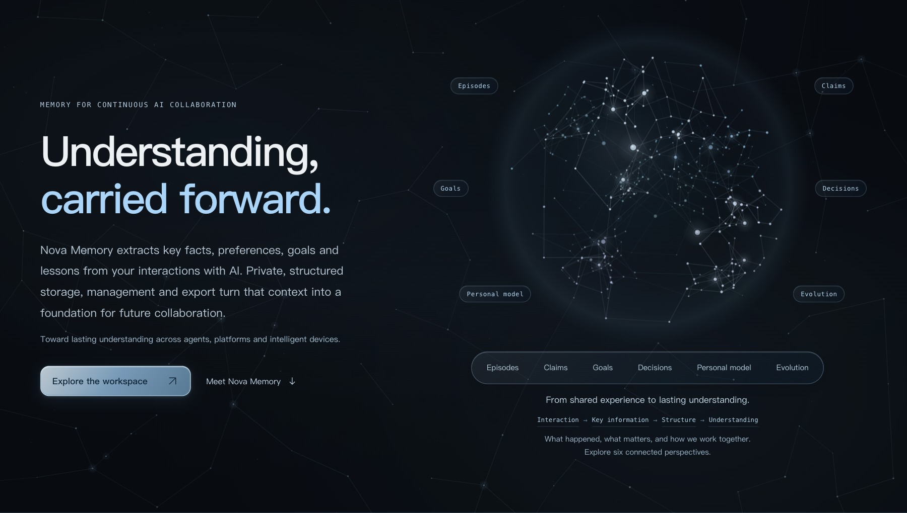
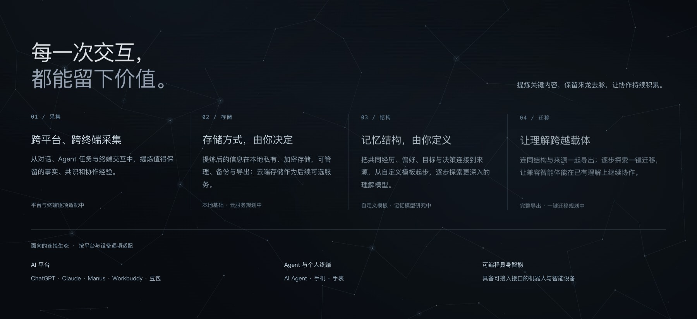
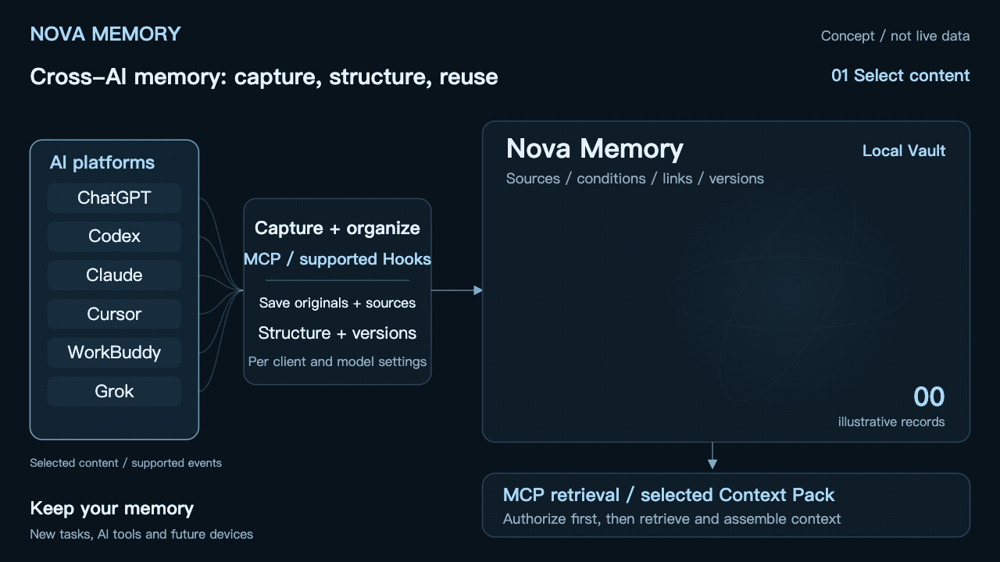
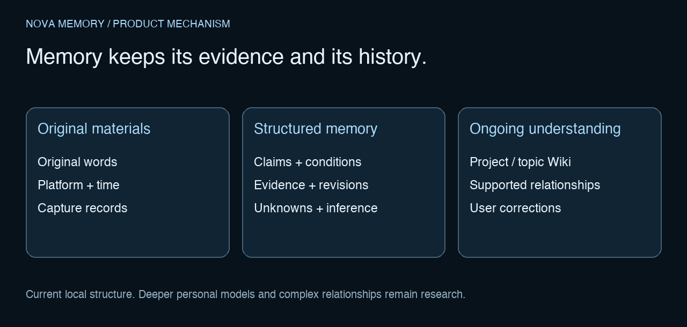
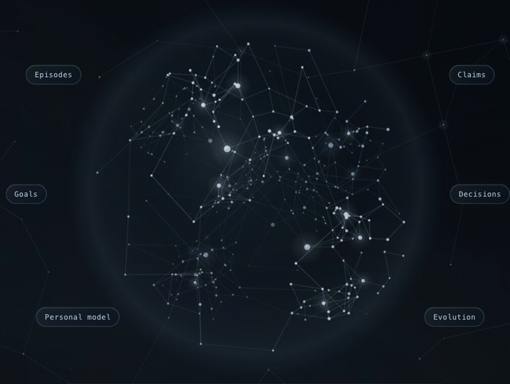
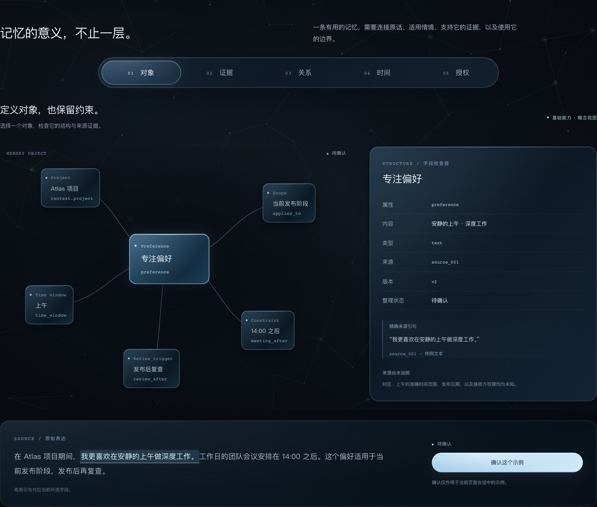
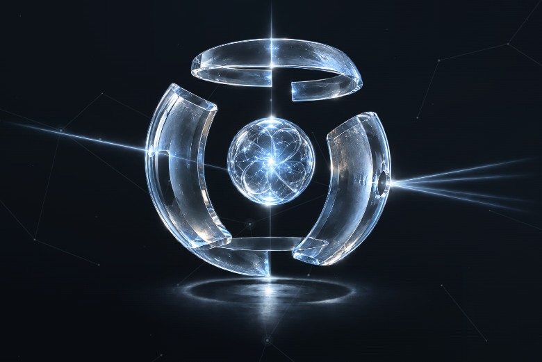
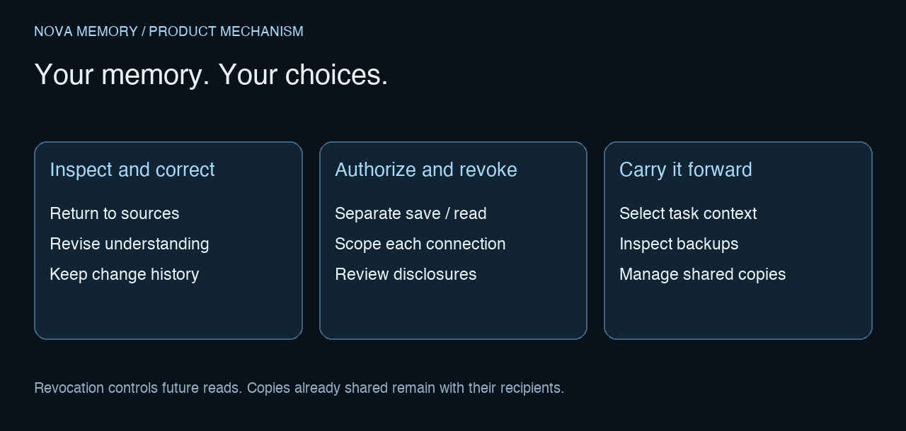
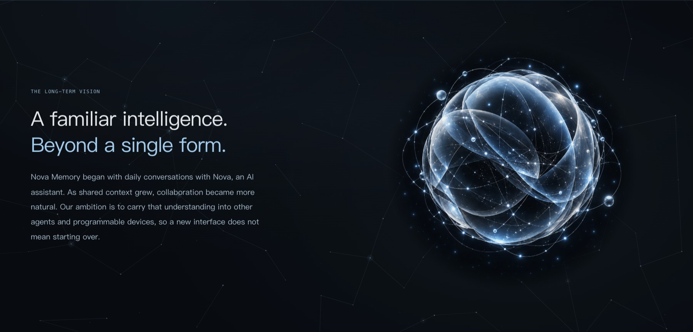

<div align="center">


# Nova Memory

**v0.1.0 · 本地源碼預覽**

[更新日誌](CHANGELOG.md) · [版本說明](docs/VERSIONING.md)

[English](README.md) · [简体中文](README.zh-Hans.md) · 繁體中文 · [日本語](README.ja.md)

**把記憶帶到不同的 AI 工具裏。繼續和熟悉的同伴一起工作。**

把以後還要用的項目上下文存下來，連同來源、適用條件和後來的修正。在你授權的下一次協作裏繼續使用。

這裡的 v0.1.0 是 Apple 晶片 Mac 上的本地源碼預覽。打開之前需要自己構建。開發者簽名、公證和跨設備安裝包仍在準備，當前桌面控制項可能是中文。版本號或 GitHub Release 只是給這次預覽命名，本身不是簽名安裝包，也不是已經完成的真實環境驗收。[快速開始](#快速開始)

[](LICENSE) [](#快速開始)

[快速開始](#快速開始) · [起點](#從通勤交談開始) · [產品](#產品) · [工作台](#走進工作台) · [記憶結構](#記憶結構如何生長) · [連接](#連接正在使用的-ai) · [願景](#長期願景)

</div>



你已經向一個 AI 講過項目、偏好、決定和下一步。換一個工具，或新開一段對話，這些背景常常又要再講一遍。

Nova Memory 想把有用的協作上下文留成你可以自己維護的材料。原話、來源、當時重要的條件，以及後來的修改，都可以留下來。下一次獲準的 AI 需要時，再帶上相關的部分。

本頁的圖片和動畫是設計與概念材料，不是一個正在使用的 Vault 的錄屏。[配圖說明](docs/media/README.md)。

## 從通勤交談開始

Nova 是我的 AI 語音助手。上下班路上的交談，變成討論產品、工作、投資和日常生活的地方。Awesome Stock、Atom Awareness、Nova AI Digital Marketing Workspace 和 Intelligence Hub 的想法，都是在這些交談裏長出來，再回到電腦前繼續的。

一直一起做下去之後，她更熟悉這些項目和選擇的來龍去脈。Nova 開始像一個個人的 Jarvis。可上下文仍然散在不同平臺和不同對話裏。換到 Cursor 或其他研究工具時，又得把先前的決定、失敗過的做法和還沒解決的問題重新講一遍。

Nova Memory 從這個需要裏長出來。它是 Atom Awareness 的第二條產品線：把共同經歷留成可以長期維護的記錄，讓熟悉的同伴能夠跨 AI 平臺繼續工作，以後也有可能跨設備。熟悉的同伴和 Jarvis，是這段由來和後面的願景，不是說當前版本會自動把一個身份搬過去。

## 產品

四件相連的事帶著產品，從一次值得留下的交互，到持續的協作。



| 支點 | 你得到什麼 | 設計上在意的事 |
| --- | --- | --- |
| **採集 Capture** | 把有用的對話、任務和材料收到一處 | 連接配置一次，之後用一句短請求或一個簡單動作保存 |
| **擁有 Own** | 在自己的 Vault 裏管理記憶、備份和導出 | 讓存放位置、處理選擇和訪問範圍看得見、控得住 |
| **結構 Structure** | 把經歷、偏好、目標和決定連同依據組織起來 | 保留情境、時間、不確定和修正，讓結構隨著使用形成 |
| **遷移 Move** | 把相關理解帶到另一個 AI 或另一項任務 | 讓工具連到同一記憶庫，或選出一份一次性上下文包 |

選中的內容經 MCP 連接器或插件進來；受支持的 Hook 事件也可以把材料送到採集界面。原件和來源先寫入本地 Vault，再異步提取條件、關係和版本。讀取前會檢查授權，然後通過 MCP 或一份上下文包交付限定範圍的內容。共用一個記憶庫並不要求雲託管。

上下文包就是這種復用的一次性形式。你選出幾條記憶，先看文字，再複製或下載到另一個工具。那個工具會留下這份副本。



*概念架構動畫。節點和連線表示積累；幾何位置並不編碼真實的語義距離。實際關係取決於來源和結構規則。各平臺能做到哪一步，見下面的說明。*

例如：「Atlas 發布階段，工作日的團隊會議放在 14:00 之後，緊急事故除外。」一條有用的記憶要同時帶著這個偏好、項目階段和例外。情況變了，就修正它，並保留先前版本和理由。

## 走進工作台

### 看見記憶如何相連

記憶空間呈現當前 Vault 的來源、提取記錄、主題和有依據的關係。選中一個節點或一條邊，可以回到對應的對象和依據。同一投影也可以用列表查看。

視圖會反映材料和版本的變化。關係寫明了來源，而積累下來的結構品質仍要在使用中繼續評估。

### 先把值得留下的內容收下

可以在工作台裏保存文字，也可以在已連接的 AI 裏說 **「Save to Nova Memory」**。平臺連接配置好之後，日常保存就用這個已有入口。

原文先保存。清洗和結構化按所選模型和整理設置進行。還沒配置模型時，材料會留著等待。已保存、處理中和可復用是分開的狀態。

### 把意思和依據放在一起

按項目和主題瀏覽正在形成的理解，查看來源和條件，查看版本，並為另一項任務選出相關記憶。相同的說法可以放在一起顯示，各自的依據仍然保留。

「更喜歡下午開會」只有在同時知道是誰說的、適用於哪個項目、有什麼例外、何時再看一遍時，才比較有用。

### 一邊用一邊修正

用戶陳述、提取出的主張和 AI 推斷各自保留角色。計劃、否定和未知資訊保持可區分。告訴 Nova 哪裡不準確，或一句話適用於什麼情況，並讓這次修正帶著依據和歷史留下來。

提取品質取決於所配置的模型。原件、處理狀態和修訂讓你可以查看並改進結果。

### 在另一個 AI 裏繼續

選定平臺後，工作台準備相應的連接步驟和配置。持續使用時，獲準的客戶端可以讀取同一個 Vault。臨時任務則選出幾條記憶，預覽上下文，再複製或下載。

任務接續可以保留目標、已完成的工作、理由、限制、失敗過的嘗試和下一步。一條已有記憶可以成為新任務的起點。

複製出去的文本由接收方保存。後來的修正和撤權只作用於之後的 Nova 讀取；已經分享出去的副本需要在接收工具裏另行管理。

## 記憶結構如何生長

**NMM · Nova Memory Model** 是 Nova 記憶結構研究的代號。它探索經歷、主張、目標和決定怎樣形成可追溯、可修訂、能演進的理解。


產品把這件事分成三層。



| 層次 | 保留或組織的內容 | 對以後協作的用處 |
| --- | --- | --- |
| **原始材料** | 原話、平臺、角色、時間和採集記錄 | 回到當時實際說過的話 |
| **結構化記憶** | 對象、陳述、條件、時間、依據和版本 | 在合適的情境裡找到並使用一條記憶 |
| **持續理解** | 項目與主題 Wiki、歸併和有依據的關係 | 把散落的材料收成可以繼續完善的上下文 |

結構演進時，有些基礎需要保持可靠。

- **來源。** 一條陳述能追溯到支持它的材料。
- **情境。** 留下項目、階段、例外和適用範圍。
- **時間。** 區分何時記錄、何時適用，以及後來如何改變。
- **不確定。** 讓未知、推斷和未完成的目標仍然認得出來。
- **修訂。** 保留先前版本和修正理由。
- **使用邊界。** 按當前授權衡量接收方和範圍。

六個相連的研究視角在這個基礎上展開。

<p align="center">
  
</p>

| 視角 | 它要探問的問題 |
| --- | --- |
| **經歷 Episodes** | 發生過什麼，誰參與，原來的情境是什麼？ |
| **主張 Claims** | 說了什麼，在什麼條件下，有哪些支持或衝突的依據？ |
| **目標 Goals** | 想達到什麼，受什麼約束，怎樣算完成？ |
| **決定 Decisions** | 做了哪些取捨，為什麼，結果帶來了什麼經驗？ |
| **個人模型 Personal model** | 哪些偏好和協作方式反覆出現，例外在哪裡？ |
| **演化 Evolution** | 新資訊應該怎樣修訂先前的理解？ |

當前產品已有結構化記錄、來源、版本、Wiki 和圖譜投影。更深的個人模型、複雜關係和跨設備投影仍是要通過使用來驗證的研究方向。

<details>
<summary>查看英文官網的結構概念</summary>



</details>

## 記憶由你掌握





**留下什麼，可以改變。** 查看、編輯、糾正和刪除已保存的材料，同時分清原件和派生理解的狀態。

**誰能使用，由你決定。** 採集和讀取權限分開管理，可以查看披露並撤銷以後的訪問。

**上下文可以帶走。** 記憶與來源、結構和歷史放在一起管理，並提供上下文分享和加密備份檢查。

本地 Vault 使用加密存儲。模型和整理開關由你選擇。本機加密並不能在你使用遠程模型或遠程 AI 連接時把所選內容留在本地：相應內容會按設置發送到目標服務。撤權只停止以後的 Nova 讀取，不能把已經複製到其他工具的文本收回來。

## 連接正在使用的 AI

當前重點包括 **ChatGPT、Codex、Claude Code、WorkBuddy、Grok 與 Cursor**，通過 MCP、平臺連接器和適用的生命周期 Hook 組織。這些行並不是同樣完成的接入。Claude 聊天和 Claude Desktop 與 Claude Code 是不同入口；Code 的記錄不能代表它們。客戶端、入口和認證分別看待，這裡的項目記錄也不是獨立驗收。

| 平臺 | 接入路徑 | 當前證據或設置邊界 |
| --- | --- | --- |
| **Cursor** | 本機 MCP 配置，保存、檢索與任務接續 | 已有 IDE 新會話、糾正和重新授權記錄 |
| **Codex** | 顯式 MCP 保存與讀取，CLI 可選採集 Hook | 已有 CLI 工具調用及 Hook 入庫、補傳和撤權記錄 |
| **Claude Code** | 本機 MCP 配置 | 已有 Code 客戶端保存與讀取記錄 |
| **Claude 聊天 / Desktop** | 不是 Claude Code 那條路徑 | 需要各自核對；Code 記錄不覆蓋聊天或 Desktop |
| **WorkBuddy** | 用戶級 MCP 配置 | 已有客戶端保存與讀取記錄；項目級配置另行核對 |
| **ChatGPT** | 遠程 MCP 網關和認證隧道 | 需要可達的地址和對應賬號配置 |
| **Grok** | grok.com 上的自定義 MCP 連接器 | 公網可達性和賬號認證兼容仍逐項核對 |

工作台會給出所選平臺的步驟。其他兼容 MCP 的客戶端可以沿標準接口適配。自動採集按平臺逐步增加；目前有實際 Hook 記錄的是 Codex CLI。這不是所有平臺都已自動採集。

## 快速開始

公開交付的是本地源碼預覽。開發者簽名、公證和跨設備安裝包檢查仍在準備。

**構建條件**

- Apple 晶片 Mac，macOS 14 或更新版本。
- 帶 macOS SDK 的 Xcode、Rust 1.97.1、Python 3.11 或更新版本。

```sh
git clone https://github.com/JayeeeJY/nova-memory.git
cd nova-memory
cargo fetch --locked
./script/build_and_run.sh
```

打開 App。當前桌面控制項可能是中文；這份預覽沒有另寫一套英文控制項名稱。入門說明裏的標籤是：「开始本地使用」打開本地工作區，「留住一段记忆」保存第一條材料，「连接」走向另一個 AI。準備好後再配置模型。這些是要照著做的說明，不是一次已經完成的 Mac 運行記錄。

預設數據目錄為 `~/Library/Application Support/Nova Memory/local-workspace-v03`。模型還沒配好時，原文也可以先保存。

[完整入門說明](docs/GETTING_STARTED.zh-Hant.md) · [English](docs/GETTING_STARTED.en.md) · [简体中文](docs/GETTING_STARTED.md) · [日本語](docs/GETTING_STARTED.ja.md) · [反饋問題](https://github.com/JayeeeJY/nova-memory/issues) · [參與貢獻](CONTRIBUTING.md)

## 長期願景

起點是一個個人記憶庫。材料積累之後，記憶結構還需要繼續研究：怎樣歸併重複的說法，怎樣用新依據修訂早先的判斷，以及怎樣區分一時的情緒和持久的偏好。在工具之間移動時，除了內容，上下文、關係和改變的理由也應留下來。

眼鏡是另一個有希望的入口。一個 Even Hub 應用也許可以用手機側 SDK 與 Even G2 交互，並訪問獲準的記憶服務。這仍是需要設備驗證的未來開發；見 [Even Hub 官方架構](https://hub.evenrealities.com/docs/get-started/architecture)。

AI 會跨很多平臺和設備。我們希望手機上的一段對話能在電腦或眼鏡上繼續，多年以後仍能找到共同經歷：一個熟悉的同伴跨越模型和設備，更接近日常生活裏的 Jarvis。



## 一起做

Nova Memory 由 Evan 創建並維護，是 Atom Awareness 的第二條產品線。做個人記憶、智能體和可穿戴設備的開發者、研究者和投資人，歡迎來聯繫。

- [提出問題或產品想法](https://github.com/JayeeeJY/nova-memory/issues)。
- 閱讀 [CONTRIBUTING.md](CONTRIBUTING.md)，參與採集適配、工作台、記憶結構或連接。
- [關注倉庫和以後的版本](https://github.com/JayeeeJY/nova-memory)。

本地產品代碼採用 [AGPL-3.0-only](LICENSE)，依賴保留各自許可。軟件範圍、品牌和對應源碼交付見 [LICENSE_SCOPE.md](LICENSE_SCOPE.md)。

官網圖片來自 [Nova Memory 官網](https://nova-memory.atom-evan001.chatgpt.site/)，當前入口可能需要訪問權限。本介紹的配圖使用英文視覺。官網各段展示的是設計與研究方向，是現有英文界面的本地渲染。橫向動畫說明採集、結構化和限定範圍的復用。記憶球動畫是該英文官網的本地渲染。兩者都不是正在使用的個人 Vault 的錄屏。架構動畫和分層圖說明機制。幾何連線不能當作 Vault 裏真實語義關係的證據。見 [配圖說明](docs/media/README.md)。

---

Nova Memory / **Powered by Atom Awareness**<br>
Independent AI Product & Research Studio · Make complexity perceivable.
